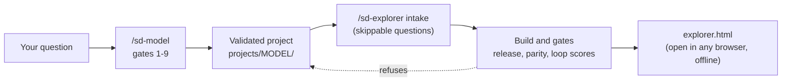

<!-- Generated by engine/build_docs.py from docs/src/README.md. Edit the template, then run `python -I engine/build_docs.py`. -->
# sd-forge

A licence-gated system dynamics (SD) knowledge base with two skills on top of it.

- `/sd-model "<question>"` builds a stock-and-flow model for a question and validates it with `engine/validate.py`, in one of three run modes: `full` stops for approval at every gate, `checkpoint` (the default) pauses once after gate 5 and once at the end, `express` does not pause (`/sd-model --mode express "<question>"`). Whatever the mode, no result is shown until every validation test passes, and a model built without every pause is labelled as not reviewed by a person.
- `/sd-explorer projects/<m>` turns a validated project into one self-contained `explorer.html`. The page re-runs the validated model live in the browser. Its JavaScript engine is generated from the committed PySD model, and the build proves it matches PySD before the page is written.

Status: built and tested on 2 projects of the same model family only (`bass-b2b-adoption` and `saas-churn-vs-winrate`, which extends it). Anything outside the tested scope fails the build loudly instead of being guessed. A third project, `car-dealership-profit`, also ships with its page and passes the repository checks; the browser test cases were written for the two above.

## Pipeline



Gate 10 of `/sd-model` is the `/sd-explorer` step. It starts only after gate 9 is approved.

## Get the code

There are two ways to get it. Either way, keep the folder somewhere permanent: the skills read the engine from it, so do not move or delete it later. macOS and Linux are the tested platforms; Windows has not been tested (see "Windows" in the quick start guide).

- **Simple:** on the repository page choose Code, then Download ZIP. Unpack it and double-click `setup.command` (or run it in a terminal). It offers to copy the folder somewhere permanent, builds the Python environment itself and links the skills into Claude Code, and into Codex if you have it (see "Install once, use anywhere" in the quick start guide).
- **Advanced:** clone it, and install the same way:

```bash
git clone https://github.com/fourpoint669/sd-forge.git "$HOME/sd-forge"
cd "$HOME/sd-forge"
bash install-skills.sh
```

The commands below are for working inside the repository; run them from its folder.

## Prerequisites

- **Python 3.11 or 3.12** (PySD may not support newer). From the repository root:

  ```bash
  python3.12 -m venv .venv && .venv/bin/pip install -r engine/requirements.txt
  ```

- **node.** The parity gate runs the page's engine under node on every build and never skips: without node, the build and every test that builds a page fail.
- **Playwright with Chromium**, for the browser tests. Install Playwright in a folder that node resolves from the repository (for example its parent folder), install Chromium, then check from the repository root that node can load it:

  ```bash
  (cd .. && npm install --no-save playwright)
  ```

  ```bash
  (cd .. && npx playwright install chromium)
  ```

  ```bash
  node -e "require('playwright')"
  ```

  The check must finish without an error. Without Playwright the browser tests are skipped, not failed: a recorded run of the suite gave 671 passed and 237 skipped (0 failed). A release run adds `--require-browser` (or sets `SD_REQUIRE_BROWSER=1`), so a missing browser fails the run instead of being skipped.

## Quick start

```bash
python3.12 -m venv .venv && .venv/bin/pip install -r engine/requirements.txt
.venv/bin/python -I engine/validate.py projects/bass-b2b-adoption/validation.toml
.venv/bin/python -I engine/build_explorer.py projects/bass-b2b-adoption
.venv/bin/python -I engine/check_repo.py --require-explorer
.venv/bin/python -I -m pytest engine/tests -q
```

Then open `projects/bass-b2b-adoption/explorer.html` in a browser. To use the two skills from any folder, run `install-skills.sh` once (see "Install once, use anywhere" in the quick start guide). For a release run, use the browser-required test command, so missing browser tooling fails instead of skipping:

```bash
.venv/bin/python -I -m pytest engine/tests -q --require-browser
```

## Manuals

- [Quick start guide](docs/QUICKSTART.md): what to type, what you will be asked, how to read the page, what to do if the build refuses. PDF copies of all three documents are in [docs/pdf](docs/pdf/).
- [Maintainer and reviewer manual](docs/MANUAL.md): every gate and check with its tolerance, every refusal message, file layout, how to add a project, known limits, troubleshooting, glossary.

## Validated projects

| Project | Validation | Explorer page | Parity with PySD (largest scale-relative difference) | Loop scores |
|---|---|---|---|---|
| `bass-b2b-adoption` | all tests pass | `projects/bass-b2b-adoption/explorer.html` (316 KB) | 0 | live |
| `saas-churn-vs-winrate` | all tests pass (+ `checks.py`) | `projects/saas-churn-vs-winrate/explorer.html` (497 KB) | 5.5e-16 | live |

Each figure above is read from the project's `explorer_parity.json` and `validation_results.json` when this file is generated.

## Repository layout

| Path | Content |
|---|---|
| `raw/` | redistributable source material only, original paths kept, licence files included (`raw/_private/` is gitignored) |
| `library/` | own-words notes: archetypes, units, function compatibility, modelling checklist, validation tests |
| `engine/` | validation (`validate.py`, `loop_detector.py`), explorer build (`build_explorer.py` and the `explorer_*.py` modules, `export_js.py`, `explorer_template/`), repository checks (`check_repo.py`), docs (`build_docs.py`), tests (`tests/`) |
| `projects/<m>/` | one validated model per folder: gate files, `model/` (`.mdl` and PySD `.py`), validation outputs, `summary.md`, and the explorer page |
| `.claude/skills/`, `.claude/commands/` | the `/sd-model` and `/sd-explorer` skills |
| `install-skills.sh`, `uninstall-skills.sh` | one-time install of the skills for use from any folder, and its removal |
| `MANIFEST.csv` | one row per source file with its licence, and a `pointer:` row for each source that was not downloaded |
| `docs/` | these manuals (`docs/src/` holds their templates) |

## Licence policy

- A source is downloaded only if its licence permits redistribution and `commercial_use` is `yes` or `share-alike`.
- `no` (any non-commercial licence) and copyrighted books or papers: a pointer row only, with own-words notes in `library/notes/`, each naming the work it came from and the earlier authors that work itself credits.
- `unclear` or unfetchable: not downloaded; kept as a `pointer:` row in `MANIFEST.csv`.
- sd-forge's own files are licensed under the Apache License (see `LICENSE` and `NOTICE`). Material under `raw/` keeps its authors' licence (see `THIRD_PARTY_LICENSES.md`) and none of it is share-alike at present; if you believe a file there is yours and was not licensed for redistribution, open an issue and it will be removed. AI coding assistants helped write this repository, under human review. Vensim is a trademark of its owner and is named here only to describe file-format compatibility; this project is not affiliated with or endorsed by it.

## Key takeaways

- A result is shown only after validation passes, and the explorer page is refused unless the validated model files are the ones on disk.
- The page is a view of the validated model: its engine is checked against PySD on every build, and uncertainty bands appear only where the Monte Carlo run applies.
- Scope is narrow and stated: 2 projects of one model family, headless Chromium only. See the "Known limits" section of the manual for what is not verified. Models are code: validating or building one translates it with PySD and runs the result, so a `.mdl`, an XMILE file or a project folder from someone else can run commands as you. Use only models you trust; the process and timeout limit runaway runs, not what the code may do.
