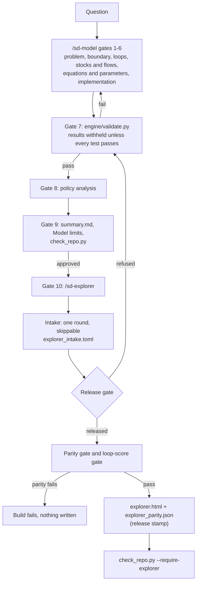
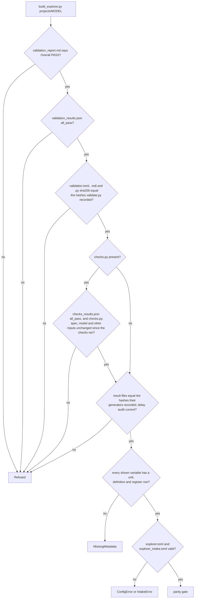
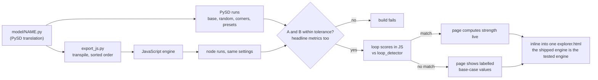

# sd-forge manual: maintainers and reviewers

This manual describes what is built and tested. Every tolerance, count, size and message below is filled in by `engine/build_docs.py`, from the code, the build outputs and real runs. Edit `docs/src/MANUAL.md`, then regenerate.

Contents: scope; pipeline; `/sd-model` gates; run modes; `/sd-explorer` steps; checks and tolerances; refusal gates and messages; build and parity flow; files per project; intake; the page; adding a project; known limits and what is not verified; troubleshooting; glossary; repository layout and rerun.

## Scope

- The explorer was built and tested on {{n_projects}} projects of the same model family: `{{bass_name}}` and `{{saas_name}}` (which extends it).
- Any model construct outside the transpiler's allowlist fails the build loudly. The allowlist, as stated in `engine/export_js.py`:

```text
{{export_allowlist}}
```

- Browser behaviour is tested in headless Chromium only (see "Known limits").

## Pipeline



## `/sd-model` gates

Each gate writes its files in `projects/<m>/` and stops for approval. This table is read from `.claude/skills/sd-model/SKILL.md`:

{{gate_table}}

## Run modes

`/sd-model --mode full|checkpoint|express "<question>"` selects how often the pipeline pauses; no argument means `checkpoint`. The pauses are data in `engine/run_mode.py`, and a test compares them with the table in the skill.

{{run_modes_table}}

In every mode: gate 1 still refuses a question that names no decision; a gate 7 failure still stops the run; the explorer refusal gates are not touched; no tolerance is loosened.

In `checkpoint` and `express` the project records what no person reviewed, and `engine/check_repo.py` fails when a record is missing or disagrees (the rule is read from `engine/run_mode.py`):

{{run_mode_records}}

The line each mode puts at the top of `summary.md` (print it with `.venv/bin/python -I engine/run_mode.py label <mode>`):

{{run_mode_labels}}

`.venv/bin/python -I engine/run_mode.py check projects/<m>` lists what is missing. A project with no run-mode record is a `full` project built before modes existed and needs nothing more. The records show that the labelling exists and agrees with itself; they cannot show that an Approval line is true.

## `/sd-explorer` steps

The skill is `.claude/skills/sd-explorer/SKILL.md`; the command is `.claude/commands/sd-explorer.md`.

1. **Intake.** `.venv/bin/python -I engine/explorer_intake.py questions projects/<m>` prints the questions as JSON. They are asked in one round; every one is skippable. The answers are recorded with `.venv/bin/python -I engine/explorer_intake.py record projects/<m> --answers '<json>'`. If nobody can answer, `--mode unattended` records the defaults. Details are under "Intake" below.
2. **Build.** `.venv/bin/python -I engine/build_explorer.py projects/<m>` runs end to end without stopping. Its steps, from `engine/build_explorer.py`:

{{build_steps}}

3. **Verify.** `.venv/bin/python -I engine/check_repo.py --require-explorer`, `.venv/bin/python -I engine/contrast_check.py`, and `{{release_test}}` (fails, instead of skipping, when Playwright or Chromium is missing).
4. **Report.** Page size, parity maxima, loop-score gate and mode, each intake setting (chosen or assumed), and what was not verified.

## Checks and tolerances

| Check | Tolerance or rule | Where it runs |
|---|---|---|
| Model validation T0 to T8 | see the block below (Monte Carlo N at least {{mc_min_n}}; dt halving under {{dt_tol_pct}}%; conservation drift under {{cons_tol}}; peak time within {{peak_steps}} steps) | `engine/validate.py`, gate 7 |
| Project checks | defined per project | `projects/<m>/checks.py` (shipped projects with one: {{checks_projects}}) |
| Release gate | validation PASS and `all_pass`; the sha256 of `validation.toml`, the `.mdl` and the `.py` equal the ones `validate.py` recorded; every result file `validate.py` wrote (the set derived from the spec) equals the hash it recorded after writing it; where `checks.py` exists, the checks pass and every file they read (the checks code, spec, model, and any other project's files named in `checks.py`) is unchanged since they ran; where `gate8_results.json` exists, every file `gate8_analysis.py` read and wrote is unchanged since it ran; `delay_audit.json` equals a fresh audit of the current model. `check_repo.py` runs all of this on every project, with or without a page | `engine/explorer_release.py`, called by the build and by `check_repo.py` |
| Parity with PySD | per series, S = max abs(py). A: max abs(js − py) / S ≤ {{parity_tol}}. B: abs(js − py) / abs(py) ≤ {{parity_tol}} wherever abs(py) ≥ {{pointwise_floor}} · S. An all-zero series must match exactly. Base, {{parity_random}} random lever settings (seed {{parity_seed}}), corners and presets; every stock, every variable and every headline metric | `engine/explorer_parity.py`, during the build; the build fails otherwise |
| Link and loop scores | the same scale-normalised metric ≤ {{ltm_tol}}, on base and {{ltm_random}} random settings, for every link score and loop score against `engine/loop_detector.py` | `engine/explorer_ltm.py`, during the build; on failure the page shows labelled base-case values |
| Shipped page | release gate passes now; stamp equals current files and template; page sha256 equals the recorded one; parity within {{release_tol}}; no external references; under {{size_limit_mb}} MB | `engine/explorer_release.py` via `check_repo.py` |
| Contrast | text {{contrast_text_ratio}}, graphics and controls {{contrast_graphic_ratio}} (WCAG AA), both themes; scenario colours separated under simulated colour-vision deficiency (floor {{cvd_floor}}, normal vision {{normal_floor}}) | `engine/contrast_check.py`, and `engine/tests/test_contrast.py` |
| Documentation drift | rendered docs equal a fresh render; every command, path, flag, link and slash command exists; no hand-typed numbers in the templates; screenshot from the current build, under {{img_limit_kb}} KB | `engine/build_docs.py --check`, and `engine/tests/test_docs.py` |

The validation tests, as stated in `engine/validate.py`:

{{validate_tests}}

What `check_repo.py` checks, as stated in its docstring:

{{check_repo_checks}}

Achieved on the shipped pages, read from each `explorer_parity.json`:

| Project | Parity runs | Series | A (max) | B (max) | Headline metrics (max) | Loop-score runs | Links (max) | Loops (max) | Mode |
|---|---|---|---|---|---|---|---|---|---|
| `{{bass_name}}` | {{bass_parity_runs}} | {{bass_parity_series}} | {{bass_parity_a}} | {{bass_parity_b}} | {{bass_headline}} | {{bass_ltm_runs}} | {{bass_ltm_link}} | {{bass_ltm_loop}} | {{bass_ltm_mode}} |
| `{{saas_name}}` | {{saas_parity_runs}} | {{saas_parity_series}} | {{saas_parity_a}} | {{saas_parity_b}} | {{saas_headline}} | {{saas_ltm_runs}} | {{saas_ltm_link}} | {{saas_ltm_loop}} | {{saas_ltm_mode}} |

The test suite (`engine/tests/`), one row per file, from each file's docstring:

{{test_files}}

## Refusal gates and messages



Every refusal, produced by breaking a temporary copy of a project and running the build:

{{refusal_table}}

`check_repo.py` reports a model edited after validation like this (real run on a temporary copy):

{{check_repo_example}}

Failures that the shipped projects cannot trigger without changing engine code are quoted from the source:

{{source_messages}}

### What the gates protect against

The table is read from `engine/explorer_release.py` (`PROTECTIONS`, `NOT_PROTECTED`).

{{gate_protections}}

### What the release stamp covers

{{stamp_files}}

The stamp records files as they are at build time, so on its own it would accept a result file edited before a build. Result files are therefore also bound at the moment they are written: `validate.py` records the sha256 of each result file in `validation_results.json` after writing it, `gate8_analysis.py` records the files it read and wrote in `gate8_results.json`, and `delay_audit.json` is compared with a fresh audit of the model. The release gate checks all of these before every build. The page template's hash is stamped too. Files of another project that `checks.py` reads (the `{{bass_name}}` spec and model, for `{{saas_name}}`) are not stamped. They are bound through `checks_results.json`, whose recorded hashes the release gate compares with the current files on every build and on every `check_repo.py` run.

The release module's own description:

{{release_doc}}

## Build and parity flow



The build reads the engine script back out of the finished HTML and checks that it equals the tested text, so the bytes that ship are the bytes that were compared. Builds are deterministic.

## Where the engine and the projects are

Two folders are involved. The **engine home** holds `engine/`, `library/`, `raw/` and the shipped example projects: the folder `install-skills.sh` was run from. The **projects root** holds one folder per model.

| Setting | Order of precedence | Fails when |
|---|---|---|
| Engine home | environment variable `SD_FORGE_HOME`, then the first line of `~/.config/sd-forge/home` | neither exists, the file is empty, or the folder has no `engine/validate.py` (the message names the source and the path) |
| Projects root | the `--projects-root` option, then environment variable `SD_PROJECTS_DIR`, then the current folder | never; inside the engine home the default is its own `projects/` folder, so the in-repository commands are unchanged |

`engine/sd_paths.py` implements both (`python -I engine/sd_paths.py check` prints them). A project argument that is a path is used as given; a bare name that does not exist as given is looked up in the projects root. The option is understood by `check_repo.py`, `build_explorer.py`, `explorer_intake.py`, `delay_audit.py`, `explorer_structure.py` and `run_mode.py`; `validate.py` takes the path of a spec and needs no root. Resolving paths changes no gate, tolerance or threshold.

- `check_repo.py` runs its repository checks (sources, licences, translation status) on the engine home from any folder, and its project checks on the projects root. When the root is only the current-folder default, a subfolder counts as a project if it holds `validation.toml` or `01_problem.md`, so unrelated folders are not reported; with the option, the environment setting or inside the engine home every subfolder is a project.
- The git remote and tracked-private-file checks of `check_repo.py` apply whenever the engine home has a `.git` entry (folder, file or link). Git must then work: a missing git, a repository git cannot read, an unreadable `.git` or a wrong remote is an error. Only a folder with no `.git` at all (an unpacked zip, or a folder inside some other repository) skips them, and no git process is started for it; the script prints a note. A projects root named with `--projects-root` or `SD_PROJECTS_DIR` that does not exist is an error, and the scripts that take a project report a missing one instead of a traceback or a silent success.
- The release stamp and the hash checks read the project's own files from its folder. The files of another project that a project's checks depend on are recorded under `projects/<name>/...` and are looked up as `<name>/...` in the projects root, with no fallback to the engine home: if that project is missing or changed, the build and `check_repo.py` refuse.
- Scripts inside the shipped example projects (`checks.py`, `gate8_analysis.py`) find the engine from the repository layout, and their hashes are part of the recorded evidence, so they were not changed.

## Files per project

| File | Written by | Purpose |
|---|---|---|
| `validation.toml` | gate 5 (by hand) | parameters with ranges, sectors, declared loops, Monte Carlo metrics, policies |
| `model/<name>.mdl`, `model/<name>.py` | gate 6 | the model and its PySD translation |
| `validation_report.md`, `validation_results.json` | `engine/validate.py` | test results; the JSON also records the sha256 of the `.mdl` and `.py` it validated |
| `mc_bands.csv`, `policy_results.csv`, `loop_dominance.json` | `engine/validate.py`, only when every test passes | Monte Carlo bands, policy results, loop dominance |
| `assumptions_register.md` | gate 5 | every parameter's source and confidence tag (the page's provenance) |
| `summary.md` | gate 9 | includes the "Model limits" section the page shows word for word; in checkpoint and express mode it opens with the not-reviewed line, which the page's Model limits repeats |
| `checks.py`, `checks_results.json` | project-specific (optional) | extra checks; the release gate requires them to pass where they exist |
| `delay_audit.json`, `delay_audit.md` | `engine/delay_audit.py` | every delay structure, read from the PySD code (report only) |
| `explorer.toml` | generated on first build, then editable | decision metric, headline metrics, chart groups (models with more than {{collapse_above}} charts get key outputs open and one collapsed group per sector) |
| `explorer_glossary.toml` | by hand | plain-language definitions for variables with no comment in the model; shown as explanatory text, not part of the validated model |
| `explorer_intake.toml` | `engine/explorer_intake.py record` | intake answers and whether each was chosen or assumed |
| `explorer.html` | `engine/build_explorer.py` | the page; never edit by hand |
| `explorer_parity.json` | `engine/build_explorer.py` | parity and loop-score results, model and engine hashes, release stamp, page sha256 |

## Intake

{{intake_table}}

The table is generated from `engine/explorer_intake.py questions projects/saas-churn-vs-winrate`. With one project named, the decision options list that project's metrics and presets; with none or several, they are generic.

- A skipped question takes its default and is recorded as `assumed default`; an answered one as `chosen at intake`.
- `--mode unattended` ignores any answers and records every default. If `explorer_intake.toml` is absent, the build assumes every default and says "No intake was recorded".
- An answer that is not an option is rejected (`IntakeError`) when it is recorded and again when the page is built.
- The page lists all {{n_intake}} settings, each with its source, at the end of the Model limits window, under "Page settings assumed or chosen when this page was built". The window says these settings are not part of the validated model.

The committed record for `{{saas_name}}` (an unattended run):

{{saas_intake_toml}}

What the answers change: the decision metric (it leads the headline and the outcome chart), the default baseline, which levers are sliders (the others are shown, held at their base value), and the audience. Decision makers open on Results with other chart groups collapsed. Modellers get every chart group open and all variables in the structure. A workshop opens on Structure with flow values shown. They never change the model, its parameters or ranges, or the gates.

## The page

- **Results tab:**
  - **Levers:** limited to the validated ranges, with an extend toggle, a persistent warning banner, and "outside validated range" labels on every affected result.
  - **Presets and baseline:** presets from `validation.toml`, and a compare-against baseline.
  - **Headline cards:** decision metric first.
  - **Compare scenarios:** up to {{scenario_slots}} saved scenarios.
  - **Charts:** small multiples with a keyboard crosshair. Monte Carlo bands appear only for the preset they belong to; the baseline's band is grey and hatched.
  - **Footer:** provenance: parity figures, the model file's sha256 and the release stamp.
- **Structure tab:**
  - **Diagram:** stock-and-flow and causal-loop views drawn from the model file, with pan, zoom, minimap, search, collapsible sectors, focus on a variable's chain, and loop isolation. R and B loops differ by colour, line style and letter.
  - **Live layer:** a time bar with play; pipe widths and moving dashes proportional to flow (still under reduced motion, where the values are shown instead); tank levels; a baseline ghost line; change colours; and a flows table as the accessible alternative.
  - **Details side tab:** the Pooling panel, with adjustable thresholds (defaults: binding at demand ÷ capacity ≥ {{pool_bind}}, build-up ≥ {{pool_build_pct}}% over {{pool_window}} time units), and delay step responses from the delay audit, labelled with the Euler dt.
  - **Loop strength side tab:** link width and opacity from loops-that-matter link scores at the time shown; badge bars showing each loop's share among the loops shown; a stacked timeline; the dominant loop by period. For `{{saas_name}}` the default view is customer-restricted, matching gate 8. The method statement says it was reimplemented from the published definition and not checked against the paper.
- **Everywhere:**
  - Model limits are shown word for word from `summary.md`.
  - System, light and dark themes.
  - Keyboard operable.
  - Mobile layout below {{mobile_breakpoint}} px wide, tested at {{phone_width}} px.
  - No external requests, under {{size_limit_mb}} MB.

## Adding a new project

1. Run `/sd-model "<question>"` through gate 9. Validation must pass: `.venv/bin/python -I engine/validate.py projects/<m>/validation.toml`. It now records the model hashes.
2. If the project has `checks.py`, run it after every validation run (it writes `checks_results.json` and a section of `validation_report.md`).
3. Run the delay audit: `.venv/bin/python -I engine/delay_audit.py projects/<m>`.
4. Run gate 10: `/sd-explorer projects/<m>`, or the intake and build commands above. If the build names variables without a definition, add them to `projects/<m>/explorer_glossary.toml`.
5. If the build fails with `Unsupported`, the model uses a construct outside the allowlist. Do not hand-edit the `.py` or the emitted JavaScript. Extending the transpiler is engine work and needs its own parity tests.
6. Check: `.venv/bin/python -I engine/check_repo.py --require-explorer` and `.venv/bin/python -I -m pytest engine/tests -q`. Several browser tests are written for the two shipped projects. A new project needs its own cases added to them.
7. Regenerate these docs: `.venv/bin/python -I engine/build_docs.py`. The README table and this manual's figures name the two shipped projects; add the new one to `PROJECTS` in `engine/build_docs.py` and to the templates.

## Known limits and what is not verified

**Models in `raw/`:**
- Some of the third-party models do not translate or run in PySD. `engine/translation_report.csv` lists each one with the reason, and `library/function_compatibility.md` explains the failure classes.

**Models are executable code:**
- PySD turns a model file into Python and the engine then runs it, in a separate `python -I` process with a timeout. A crafted comment field in a `.mdl` can become live code in that file. The timeout does not stop it, and nothing in the engine screens the generated file. Only validate, build or open models and project folders you trust.

**The explorer and its build:**
- Tested on {{n_projects}} projects of one model family only. Other models may use constructs outside the allowlist; those fail the build.
- Browsers: headless Chromium only, at fixed viewports. Not tested on real phones or touch devices, in Firefox or Safari, or with screen readers (VoiceOver, NVDA). Keyboard operation and ARIA roles are asserted in the tests, not experienced.
- Contrast is checked on the colour tokens, not on rendered pixels over charts.
- Animation and motion were not judged by a person.
- Parity between the browser's `Math.exp`/`Math.pow` and NumPy is measured only on the tested lever settings.
- The loops-that-matter method is a reimplementation from the published definition and was not checked against the paper.
- The PDF copies are checked for being present, being PDFs, matching the text they were made from and a size limit; their layout was looked at page by page for one render only. Printing them needs the internet.
- `setup.command` was run from a terminal on a copy placed in a fake Downloads folder (copy, install, rerun, uninstall) and by tests with no terminal attached. A Finder double-click, macOS's first-time warning for downloaded files and the interactive "copy it?" question were not run; a probe showed that a double-clicked `.command` starts in the home folder with a terminal attached, which is what its end-of-run pause relies on.
- Codex support was run with Codex CLI in non-interactive mode only: the skills were found through the symlinks in `~/.codex/skills`, `$sd-explorer` built a page end to end from an empty folder, and `$sd-model` refused a question with no decision at gate 1. The Codex desktop app and the interactive terminal screen were not run, nor was a full `$sd-model` run through all gates. The ChatGPT website and phone apps cannot run the skills.
- The installer prefers a Python that `install-skills.sh` lists as supported (compared in a test with the skill text). A newer Python is used only after a self-check: the shipped example is validated in a temporary copy and its result files must equal the committed ones. This was run for the newer Python on the development machine (the example reproduced exactly; the full test suite, the other two models and any still newer Python were not run), and a fake newer interpreter covers the accept and refuse paths. The check proves one example, not every model. The end-to-end install tests need the internet and a suitable Python on the machine, and are skipped without them. The macOS dialog box and the zenity dialog on Linux were run by hand only as far as their syntax; no test clicks them, and Windows is not supported (the installer is a shell script).
- The installer changes nothing in your home folder unless every step can succeed: it checks the folders it must create first, journals each change before making it, writes the home file atomically and puts everything back if a step fails part-way (tested by making the link command fail on a chosen call). It never deletes a `.venv` it did not create. Not tested: a failure of the rollback itself, a kill signal that cannot be trapped, and two installers running at once.
- Running outside the repository is tested with the explorer build, `check_repo.py` and the release gate on copies of the shipped projects in folders outside it, and with the installer in a temporary home folder. The skill text's path preamble is run by a test, but no fresh agent was run through `/sd-model` from another folder. Whether a given Claude Code version follows symlinks in `~/.claude/skills` and `~/.claude/commands` was not verified by the tests; the installer uses symlinks.
- The `/sd-explorer` skill text was not pressure-tested with a fresh agent; a test checks only that every file and command it names exists.
- Opening the `.mdl` files in Vensim is `[unverified]`.
- **Validation outputs are bit-for-bit reproducible on one machine, not across machines.** The engine version that produced each committed output, re-run on the same project files on a different machine, reproduced every CSV, band file and report exactly; a few floating-point summaries in the JSON records (`validation_results.json`, `loop_dominance.json`, `gate8_results.json`) differed in their last digits, at the level of double-precision rounding. The Python packages are pinned in `engine/requirements.txt`, so the cause is the machine (processor and the numerical code paths it takes), not the code. The values the page shows are unaffected at the precision it displays. Re-running validation on another machine writes new, self-consistent hashes; it does not reproduce the committed JSON byte for byte.
- The recorded hashes say which files `validate.py`, `checks.py` and `gate8_analysis.py` read and wrote; they do not re-run them. A record edited by hand to carry matching hashes would pass (git history is the record against that).

**The models**, word for word from each project's "Model limits" (what the page's Model limits window shows):

<details><summary>{{bass_name}}</summary>

{{bass_limits}}

</details>

<details><summary>{{saas_name}}</summary>

{{saas_limits}}

</details>

## Troubleshooting

| Symptom | Cause | Fix |
|---|---|---|
| `explorer withheld: ...` | release gate | see "Refusal gates and messages"; fix the project, never the results files |
| `... changed after validation ...` | the spec, the `.mdl`, the `.py` or a result file differs from what validation recorded | re-run `engine/validate.py` (then `checks.py` and `gate8_analysis.py` where the project has them), then rebuild |
| `check_repo.py`: `explorer.html is not the page recorded in explorer_parity.json` | the page was edited or rebuilt without its record | rebuild with `engine/build_explorer.py` |
| `check_repo.py`: `engine/explorer_template changed since the page was built` | template edited | rebuild every page |
| `parity gate failed: ...` | the JavaScript engine does not reproduce PySD within tolerance | find the construct (the record names the worst series); never loosen the tolerance |
| `node not found` | the gates need node | install node with Playwright (Chromium) |
| `build_docs.py --check` reports a stale doc | code, outputs or a template changed | `.venv/bin/python -I engine/build_docs.py`; after a page rebuild, add `--screenshots` |
| Browser tests skip | Playwright or Chromium missing (node is required in every mode: the parity and loop-score gates fail without it) | install Playwright in a folder node resolves from the repository (for example its parent): {{pw_steps_inline}}. A release run uses `--require-browser` or `SD_REQUIRE_BROWSER=1`, which fails instead of skipping |

## Glossary

- **Stock**: a quantity that accumulates over time (a tank in the diagram).
- **Flow**: a rate that changes a stock (a pipe with a valve).
- **Auxiliary**: a variable computed from others at each step.
- **Feedback loop**: a closed chain of causes. **R** (reinforcing) amplifies change; **B** (balancing) counteracts it.
- **Loop dominance**: which loop drives the behaviour in a period.
- **Loops that matter (LTM)**: a way to score how strongly each link and loop drives behaviour at each time step, from the changes in a run. Link score: abs(change in z due to x ÷ change in z), signed by the direction of the effect. A loop's score is the product of its link scores; its relative score is its share of the total.
- **Pooling**: material piling up in front of a capacity limit, such as evaluations waiting when sales capacity binds.
- **Euler integration**: the stepping method; each stock moves by its net flow × dt per step (dt = {{common_dt}} {{common_time_unit}} in every shipped model).
- **PySD**: the Python library (version {{pysd_version}} here) that translates Vensim `.mdl` files and runs them; the validated reference.
- **Parity**: the browser engine reproducing PySD's numbers within the stated tolerance.
- **Release gate**: the checks that must pass before a page is built (see "Refusal gates").
- **Release stamp**: sha256 of every project file the page rests on and of the page template, stored in the page and its parity record (see "What the release stamp covers").
- **Monte Carlo band**: percentile range (`P5–P95`, `P25–P75`) across sampled parameter values ({{common_mc_n}} samples in every shipped project).
- **Single run**: one simulation at one lever setting; never a forecast.
- **Intake**: the one round of skippable questions before a build.
- **Validated range**: the parameter range in `validation.toml` that validation covered.

## Method sources

The modelling process, the archetype catalogue and the families of validation test in this repository follow
published system dynamics practice; none of them originates here. Each note in `library/notes/` names the work it
came from, with the sections it draws on, and where that work itself credits earlier authors the note names those
authors too, so the citation chain is not collapsed onto the most recent one. `MANIFEST.csv` carries the licence
record for every cited work, and no text, table or figure from a copyrighted work is stored in this repository or
reproduced in anything it generates.

What is *not* borrowed: the T-numbers, the procedures and every numeric tolerance in
`library/validation_tests.md`, the gate sequence of the two skills, and the refusal rules. These are this
repository's own, and they carry no authority from any cited work - only from the tests in `engine/tests/`.

## Repository layout and rerun

| Path | Content |
|---|---|
| `raw/<source>/` | redistributable material only, original relative paths kept, licence files included |
| `raw/_private/` | user-supplied files; gitignored, never committed |
| `library/` | own-words notes: archetypes, units, function compatibility, process checklist, validation tests, `notes/` for books and papers |
| `engine/` | `translate_all.py` and `translation_report.csv`; `validate.py`; `loop_detector.py`; `fan_chart.py`; `verify_archetypes.py`; `check_repo.py`; `sd_paths.py`; `build_index.py`; `retag_manifest.py`; `test_index.py`; the explorer modules; `build_docs.py`; `tests/` |
| `projects/<m>/` | see "Files per project" |
| `setup.command` | the one executable: checks Python, offers to copy the folder to a permanent place, then runs `install-skills.sh` (double-click it on a Mac, or run it in a terminal) |
| `install-skills.sh`, `uninstall-skills.sh` | one-step install (Python environment, node check, skill links for Claude Code and, if present, Codex, home file) for use from any folder, and the removal of the links |
| `MANIFEST.csv` | one row per file or pointer: `path,source_url,license,commercial_use,retrieval_date,type,domain_tags,quality_tier,notes` |
| `INDEX.md` | routes a topic to a library file, a model and a validated project |
| `.github/workflows/tests.yml` | the gated run on every pull request and every push to the default branch: the archetype oracles, `engine/check_repo.py --require-explorer`, documentation and PDF drift, then the browser-required suite |

```bash
python3.12 -m venv .venv && .venv/bin/pip install -r engine/requirements.txt
.venv/bin/python -I engine/translate_all.py engine/translation_report.csv raw
.venv/bin/python -I engine/retag_manifest.py && .venv/bin/python -I engine/build_index.py
.venv/bin/python -I engine/check_repo.py --require-explorer && .venv/bin/python -I engine/test_index.py
.venv/bin/python -I engine/verify_archetypes.py
{{release_test}}
.venv/bin/python -I engine/validate.py projects/bass-b2b-adoption/validation.toml
.venv/bin/python -I engine/build_explorer.py projects/bass-b2b-adoption
.venv/bin/python -I engine/contrast_check.py
.venv/bin/python -I engine/build_docs.py --check
.venv/bin/python -I engine/build_docs.py --pdfs
```

`--pdfs` writes the PDF copies in `docs/pdf/` from the rendered documents (it needs node, Playwright and the internet, because the text and diagram scripts are loaded from a pinned CDN version while printing). `--check` fails when a document changed after its PDF was made, so run `--pdfs` after every documentation change. A PDF whose document, recorded hashes and file are all unchanged is kept as it is and reported as kept: rendering is not byte-reproducible, so remaking it would change the file and its recorded hash while the text it was made from did not move. Add `--force` to remake all three.

`engine/build_index.py` rewrites `INDEX.md`, and the committed `INDEX.md` carries hand edits the script does not reproduce. Run it with `--check` first: that prints how a fresh build differs and writes nothing, so you can see whether the difference is only those hand edits. Never run it without `--check` merely to find out whether `INDEX.md` has drifted.

## Key takeaways

- Every result rests on a gate: validation before results, the release gate before a page, parity before the page is written, and `check_repo.py` after.
- Numbers in this manual are generated from code and outputs, and a test fails if the docs drift.
- The tested scope is narrow and listed above; widen it only with new projects and their own tests.

## Presentation and accessibility

Primary controls are shortcuts to existing levers, not a sensitivity ranking. They share parameter values and resets with the Levers panel and do not change the selected comparison baseline. Supporting headline metrics and the full comparison table use disclosures. On constrained screens, structure details follow the diagram. Glass is restricted to chrome; values and data remain on opaque surfaces. Reduced transparency, increased contrast, reduced motion and forced colours have explicit fallbacks. Printing opens explanatory disclosures temporarily and restores them afterward.
