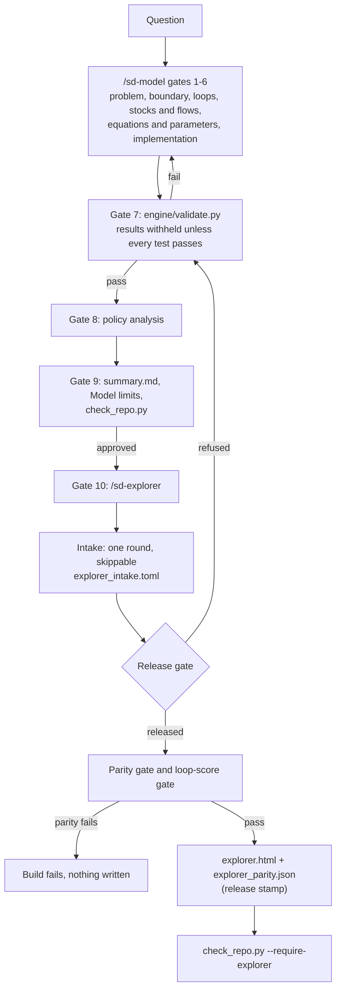
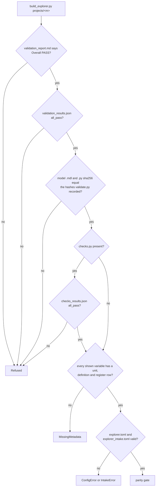
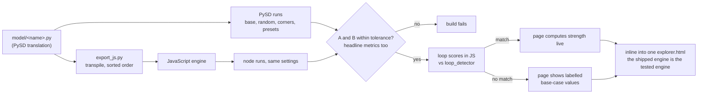

<!-- Generated by engine/build_docs.py from docs/src/MANUAL.md. Edit the template, then run `python -I engine/build_docs.py`. -->
# sd-forge manual: maintainers and reviewers

This manual describes what is built and tested. Every tolerance, count, size and message below is filled in by `engine/build_docs.py`, from the code, the build outputs and real runs. Edit `docs/src/MANUAL.md`, then regenerate.

Contents: scope; pipeline; `/sd-model` gates; `/sd-explorer` steps; checks and tolerances; refusal gates and messages; build and parity flow; files per project; intake; the page; adding a project; known limits and what is not verified; troubleshooting; glossary; repository layout and rerun.

## Scope

- The explorer was built and tested on 2 projects of the same model family: `bass-b2b-adoption` and `saas-churn-vs-winrate` (which extends it).
- Any model construct outside the transpiler's allowlist fails the build loudly. The allowlist, as stated in `engine/export_js.py`:

```text
Only these constructs are supported; anything else raises Unsupported (the build fails, nothing is guessed):
component calls, time(), control functions, numeric constants, + - * / ** unary -, comparisons, `and`/`or`/`not`
over comparisons, if_then_else(cond, lambda: a, lambda: b), float(x), np.maximum/minimum/exp/log/abs/sqrt/power/
floor/ceil/sin/cos/tan/arctan/tanh, and the Integ stateful (no SMOOTH/DELAY/lookups/data).
```

- Browser behaviour is tested in headless Chromium only (see "Known limits").

## Pipeline



## `/sd-model` gates

Each gate writes its files in `projects/<m>/` and stops for approval. This table is read from `.claude/skills/sd-model/SKILL.md`:

|---|---|
| Gate | Do | Write | Approval check |
|---|---|---|---|
| 1 Problem articulation | Key variables with units; time horizon (>= 3x longest delay); reference modes: historical (say "none" if no data; never invent data) and expected behavior over time; **the explicit decision the model informs**. | `01_problem.md` | **If the question names no decision, do not proceed: ask "What decision will this model inform?" and wait.** |
| 2 Boundary | Table: endogenous / exogenous / excluded, each with a justification. Name excluded feedbacks likely to matter. | `02_boundary.md` | user approves boundary |
| 3 Dynamic hypothesis + CLD | Mermaid CLD with link polarities; table of every loop labelled R or B with its delays; map each loop to an archetype in `library/archetypes.md` (or say none); MECE table: every driver in exactly one sector, no two variables meaning the same thing. | `03_dynamic_hypothesis.md` | user approves loops |
| 4 Stock-flow structure | Stocks, inflows, outflows, initial values; units on every variable; conservation statement (which stocks sum to what). | `04_stock_flow.md` | units and conservation stated |
| 5 Equations + parameters | Assumptions register: every parameter with base, range, distribution, unit, source, confidence tag; structural assumptions listed. Write `validation.toml` (copy the layout of `projects/bass-b2b-adoption/validation.toml`): parameters, conservation groups, extreme expectations, reference, sectors, declared loops, Monte Carlo metrics, policies. | `assumptions_register.md`, `validation.toml` | no bare numbers |
| 6 Implementation | Original Vensim `.mdl` in `model/`; PySD version via `.venv/bin/python -I -c "import sys; sys.path.insert(0,'engine'); import validate; validate.translate('<mdl>', '<model dir>')"`. Opening in Vensim is `[unverified]` unless actually tested. | `model/<name>.mdl`, `model/<name>.py` | translation runs |
| 7 Validation | `.venv/bin/python -I engine/validate.py projects/<model-name>/validation.toml`. Must exit 0: T0 translation, T1 units, T1b MECE, T1c parameter ranges (base in [low, high], ranges and extreme/policy values inside the domain), T3 extremes, T4 dt halving < 1%, T5 behavior vs reference, T6 conservation drift < 1e-6, T7 Monte Carlo N >= 1000 with 0 failed runs, T8 detected loops = declared loops. On failure: report the failing test and its numbers, diagnose the cause, fix the model or the spec, rerun. Never loosen a tolerance to pass; never redefine the reference after seeing results without saying so. | `validation_report.md`, `validation_results.json` (+ `mc_bands.csv`, `policy_results.csv`, `loop_dominance.json` only on pass) | exit code 0 |
| 8 Policy analysis | Scenarios from `[[policies]]` (equal-sized lever changes unless the user sets real programmes); leverage points explained by loops and Spearman table; ranking stability (T7b); what observation would falsify the model. | `08_policy.md` | user approves |
| 9 Output | `.venv/bin/python -I engine/fan_chart.py projects/<m>/mc_bands.csv projects/<m>/fan_chart.png "<var>:<title>"`; one-page `summary.md`: bottom line with bands, fan chart, percentile table, what limits the behavior, leverage, validation numbers, **Model limits**, licence line; `sources.md`. Run `.venv/bin/python -I engine/check_repo.py`. | `summary.md`, `fan_chart.png`, `sources.md` | `check_repo.py` exits 0 |
| 10 Explorer | Only after gate 9 is approved: invoke the `sd-explorer` skill on `projects/<m>` (one skippable intake round of up to 4 questions; unattended: defaults, recorded). The build then runs end to end without stopping. It refuses unless validation (and `checks.py`, if present) passed on the current model files. Never work around a refusal or a parity failure: go back to gate 7. | `explorer.html`, `explorer_parity.json`, `explorer_intake.toml` (+ `explorer.toml` on first build) | `check_repo.py --require-explorer` exits 0 |
|---|---|

## `/sd-explorer` steps

The skill is `.claude/skills/sd-explorer/SKILL.md`; the command is `.claude/commands/sd-explorer.md`.

1. **Intake.** `.venv/bin/python -I engine/explorer_intake.py questions projects/<m>` prints the questions as JSON. They are asked in one round; every one is skippable. The answers are recorded with `.venv/bin/python -I engine/explorer_intake.py record projects/<m> --answers '<json>'`. If nobody can answer, `--mode unattended` records the defaults. Details are under "Intake" below.
2. **Build.** `.venv/bin/python -I engine/build_explorer.py projects/<m>` runs end to end without stopping. Its steps, from `engine/build_explorer.py`:

```text
Steps (any failure stops the build; nothing is written on refusal):
  1. Refuse unless validation_report.md says 'Overall: **PASS**', validation_results.json has all_pass = true and,
     where the project has checks.py, checks_results.json exists with all_pass = true (engine/explorer_release.py).
     The sha256 of every file the release rests on is stamped into the page and explorer_parity.json, so
     check_repo.py can tell when a shipped page no longer matches its validated project.
  2. Metadata for every variable (engine/explorer_meta.py); missing metadata fails.
  3. Page settings from explorer.toml (generated with defaults if absent; engine/explorer_config.py).
  4. Emit the JS engine (engine/export_js.py) and run the parity gate against PySD (engine/explorer_parity.py),
     including the page's headline-metric code. Fails unless every check is within 1e-9.
  5. Inline template, data, engine and metrics into one HTML; refuse external references; report the size.
Writes explorer.html and explorer_parity.json next to validation.toml. Output is deterministic.
```

3. **Verify.** `.venv/bin/python -I engine/check_repo.py --require-explorer`, `.venv/bin/python -I engine/contrast_check.py`, and `.venv/bin/python -I -m pytest engine/tests -q`.
4. **Report.** Page size, parity maxima, loop-score gate and mode, each intake setting (chosen or assumed), and what was not verified.

## Checks and tolerances

| Check | Tolerance or rule | Where it runs |
|---|---|---|
| Model validation T0 to T8 | see the block below (Monte Carlo N at least 1000; dt halving under 1%; conservation drift under 1e-6; peak time within 5 steps) | `engine/validate.py`, gate 7 |
| Project checks | defined per project | `projects/<m>/checks.py` (shipped projects with one: `saas-churn-vs-winrate`) |
| Release gate | validation PASS, `all_pass`, model sha256 equal to the recorded one, project checks pass | `engine/explorer_release.py`, called by the build and by `check_repo.py` |
| Parity with PySD | per series, S = max abs(py). A: max abs(js − py) / S ≤ 1e-9. B: abs(js − py) / abs(py) ≤ 1e-9 wherever abs(py) ≥ 1e-6 · S. An all-zero series must match exactly. Base, 25 random lever settings (seed 20261029), corners and presets; every stock, every variable and every headline metric | `engine/explorer_parity.py`, during the build; the build fails otherwise |
| Link and loop scores | the same scale-normalised metric ≤ 1e-9, on base and 5 random settings, for every link score and loop score against `engine/loop_detector.py` | `engine/explorer_ltm.py`, during the build; on failure the page shows labelled base-case values |
| Shipped page | release gate passes now; stamp equals current files and template; page sha256 equals the recorded one; parity within 1e-9; no external references; under 3 MB | `engine/explorer_release.py` via `check_repo.py` |
| Contrast | text 4.5:1, graphics and controls 3.0:1 (WCAG AA), both themes; scenario colours separated under simulated colour-vision deficiency (floor 6, normal vision 15) | `engine/contrast_check.py`, and `engine/tests/test_contrast.py` |
| Documentation drift | rendered docs equal a fresh render; every command, path, flag, link and slash command exists; no hand-typed numbers in the templates; screenshot from the current build, under 300 KB | `engine/build_docs.py --check`, and `engine/tests/test_docs.py` |

The validation tests, as stated in `engine/validate.py`:

```text
Tests (thresholds from library/validation_tests.md):
  T0 translation   fresh PySD translation of the .mdl equals the committed .py, byte for byte except the key
                   order inside the dependency dictionaries (depends_on / other_deps), which PySD writes in a
                   per-process hash order (see same_translation)
  T1 units         dimensional consistency of every equation (0 mismatches, 0 unchecked)
  T1b MECE         every model variable in exactly one sector; no two variables share an equation
  T1c ranges       every parameter has base/low/high, low <= base <= high, [low, high] inside its domain,
                   loguniform low > 0; extreme and policy values stay inside the domain (no silent clipping);
                   [reference].set is exempt. Any T1c problem stops the run before any model is simulated.
  T3 extremes      each parameter at its domain bounds, 0, 0.1x and 10x base + spec expectations:
                   no NaN/inf, no stock below -1e-9 x scale, expectations hold
  T4 dt halving    max relative change of key outputs between dt and dt/2 < 1%, at base and at the
                   fastest corner of the parameter ranges
  T5 behavior      limit case (spec [reference].set, unclipped, optional own time_step) vs analytic reference: NRMSE <= nrmse_max, peak time within
                   tolerance, which may not exceed 5 steps of the reference run's own dt; base case shows the declared
                   behavior modes
  T6 conservation  conserved stock groups drift < 1e-6 relative, at base, corner and in every MC run
  T7 Monte Carlo   Latin hypercube, N >= 1000, 0 failed runs; percentile bands; Spearman importance;
                   policy ranking stability is REPORTED (T7b), not gating
  T8 loops         loops found by engine/loop_detector.py equal the declared CLD loops (same variables,
                   same polarity), all scorable; dominance timeline reported. Declared polarities must be R or B,
                   and a loop still undetermined (after any [loop_check]) fails. Polarity is read in the base run.
                   Optional [loop_check] set = {...}: ONLY loops with a zero link at base (a link that never
                   changes there, e.g. through an optional effect defaulting to 0) take their polarity from the
                   base run with those overrides; every other loop must match its declaration at base. Each
                   override must lie in that parameter's [low, high]; dominance is still from the true base run
```

What `check_repo.py` checks, as stated in its docstring:

```text
Checks: (1) every file under raw/ (except _private/) has a MANIFEST row and every
non-pointer row resolves to a file; (2) nothing under raw/ has commercial_use in
{no, unclear}; (3) raw/_private is not tracked by git; (4) every model in raw/ has
a translation_report row; (5) remote is fourpoint669/sd-forge; (6) every projects/<model>/ (built by the
/sd-model skill) has its gate files, a passing validation_results.json, a "Model limits" section in summary.md,
no `no`/`unclear` MANIFEST source used as a building block, and any share-alike source flagged in summary.md;
(7) every projects/<model>/explorer.html (built by /sd-explorer, gate 10 of /sd-model) comes from a project that
passes the explorer release gate and still matches it: release stamp equal to the current validation, model and
checks files and page template, parity and link/loop-score gates passed, page = recorded page, no external
references, under 3 MB (engine/explorer_release.py). With --require-explorer, every project must ship one;
(8) every project's model .mdl and .py equal the files validate.py hashed in validation_results.json.
--projects-root DIR checks the projects under DIR instead of projects/ (used by the tests).
```

Achieved on the shipped pages, read from each `explorer_parity.json`:

| Project | Parity runs | Series | A (max) | B (max) | Headline metrics (max) | Loop-score runs | Links (max) | Loops (max) | Mode |
|---|---|---|---|---|---|---|---|---|---|
| `bass-b2b-adoption` | 35 | 980 | 0 | 0 | 0 | 6 | 0 | 0 | live |
| `saas-churn-vs-winrate` | 35 | 3185 | 7.9e-16 | 8.8e-11 | 1.9e-16 | 6 | 2.8e-11 | 1.6e-12 | live |

The test suite (`engine/tests/`), one row per file, from each file's docstring:

| Test file | What it checks (its docstring) |
|---|---|
| `engine/tests/test_bass_oracle.py` | Analytic oracle: PySD-simulated Bass diffusion vs the closed form F(t) = (1 - exp(-(p+q)t)) / (1 + (q/p) exp(-(p+q)t)) and peak time t* = ln(q/p)/(p+q). |
| `engine/tests/test_contrast.py` | engine/contrast_check.py: WCAG AA contrast of the explorer's colour tokens, both themes. |
| `engine/tests/test_delay_audit.py` | engine/delay_audit.py: every delay structure in a validated model, read from the PySD code (report only). |
| `engine/tests/test_docs.py` | Documentation drift: README.md, docs/QUICKSTART.md and docs/MANUAL.md equal a fresh render of docs/src/ by engine/build_docs.py (every number read from code, build outputs or real refusal runs); every command, path, flag, link and slash command in them exists; the templates hold no hand-typed numbers; the screenshot comes from the current build of the SaaS page and is under the size limit; no consulting-firm names; line limits hold. |
| `engine/tests/test_explorer_build.py` | engine/build_explorer.py: refusal gates, single self-contained HTML, shipped engine == parity-tested engine. |
| `engine/tests/test_explorer_config.py` | engine/explorer_config.py: default page settings (no questions asked). |
| `engine/tests/test_explorer_dynamic.py` | Structure tab live behaviour (M3b) in headless Chromium, checked against independent PySD recomputations. |
| `engine/tests/test_explorer_intake.py` | /sd-explorer intake (engine/explorer_intake.py): one round of up to 4 skippable multiple-choice questions; skipping all still builds a valid page; every setting, assumed or chosen, is listed in the page's Model limits dialog; the refusal gates are untouched. |
| `engine/tests/test_explorer_ltm.py` | Live link and loop strength (M3c): the page's JavaScript link and loop scores against engine/loop_detector.py. |
| `engine/tests/test_explorer_ltm_ui.py` | Link and loop strength on the Structure tab (M3c), in headless Chromium: what is drawn equals the page's own ltm.js computation (itself gated against loop_detector by the build), follows the scrubber and the levers when live, and is labelled and frozen at the base case when precomputed. |
| `engine/tests/test_explorer_meta.py` | engine/explorer_meta.py: provenance for every variable the explorer shows; missing metadata fails the build. |
| `engine/tests/test_explorer_parity.py` | Parity gate: the JS engine reproduces PySD. Metric fixed at approval (never loosened to make a run pass): per series S = max_t |py|; A = max_t |js - py| / S <= 1e-9 (an all-zero series must match exactly); B = max |js - py| / |py| over points with |py| >= 1e-6 * S, <= 1e-9. These tests FAIL (never skip) when PySD or node is missing. |
| `engine/tests/test_explorer_release.py` | Every shipped explorer page comes from a project that passed validation (the refusal gate), and still matches it. |
| `engine/tests/test_explorer_skill.py` | /sd-explorer skill and command, and gate 10 in /sd-model: files exist, every command and file they name exists, and they state the tested scope. |
| `engine/tests/test_explorer_smoke.py` | Headless Chromium smoke test of the built explorers (skipped only when node or Playwright is not installed). Screenshots: set SD_EXPLORER_SHOTS=<dir>; each project writes into <dir>/<project>/. |
| `engine/tests/test_explorer_structure.py` | engine/explorer_structure.py: the diagram data behind the Structure tab (nodes, pipes, links, delays, loops, layout). |
| `engine/tests/test_explorer_structure_ui.py` | Structure tab in headless Chromium (skipped only when node or Playwright is not installed). Screenshots: SD_EXPLORER_SHOTS=<dir> writes <dir>/<project>/structure-*.png. |
| `engine/tests/test_export_js.py` | engine/export_js.py: PySD .py -> JavaScript Euler engine. Expression-level tests run without PySD or node. |
| `engine/tests/test_loop_detector.py` | engine/loop_detector.py: loop enumeration, polarity and LTM dominance against analytic results. |
| `engine/tests/test_negative.py` | validate.py must FAIL, with a specific message, on deliberately broken models, and must withhold results. |
| `engine/tests/test_safety.py` | Model code runs only in a separate `python -I` worker that a timeout kills (with anything it started); the loop detector evaluates model expressions in-process only through a strict allowlist. |
| `engine/tests/test_validate.py` | engine/validate.py: each check must catch a deliberately broken model and pass a correct one. |

## Refusal gates and messages



Every refusal, produced by breaking a temporary copy of a project and running the build:

| Condition | Error | Exact message (from a real run on a broken copy of the project) |
|---|---|---|
| validation_report.md does not say Overall PASS | `Refused` | `explorer withheld: validation_report.md does not say 'Overall: **PASS**'` |
| validation_results.json all_pass is false | `Refused` | `explorer withheld: validation_results.json: all_pass is not true` |
| validation_results.json is missing | `Refused` | `explorer withheld: validation_results.json missing or unreadable (all_pass unknown)` |
| validation_results.json has no model hashes (validated before hashes were recorded) | `Refused` | `explorer withheld: validation_results.json does not record the sha256 of the model files it validated (re-run engine/validate.py)` |
| the model .py (or .mdl) changed after validation | `Refused` | `explorer withheld: model/bass_b2b_adoption.py changed after validation (sha256 differs from validation_results.json): re-run engine/validate.py` |
| checks.py exists but checks_results.json is missing | `Refused` | `explorer withheld: checks.py exists but checks_results.json is missing or unreadable` |
| checks_results.json all_pass is false | `Refused` | `explorer withheld: checks_results.json: all_pass is not true` |
| a parameter has no row in assumptions_register.md | `MissingMetadata` | `parameter 'win rate' has no row in assumptions_register.md` |
| a shown variable has no model comment and no glossary entry | `MissingMetadata` | `'churn rate monthly' has no model definition and no entry in explorer_glossary.toml` |
| explorer.toml names a variable the model does not have | `ConfigError` | `explorer.toml: unknown names ['No Such Variable']` |
| explorer_intake.toml holds an answer that is not an option | `IntakeError` | `explorer_intake.toml: audience = 'everyone' is not an option` |

`check_repo.py` reports a model edited after validation like this (real run on a temporary copy):

```text
ERR <tmp>/projects/bass-b2b-adoption/: model/bass_b2b_adoption.mdl changed after validation (sha256 differs from validation_results.json): re-run engine/validate.py
```

Failures that the shipped projects cannot trigger without changing engine code are quoted from the source:

| Source | Message as written in the code (`{...}` is filled at run time) |
|---|---|
| `engine/build_explorer.py` | `"inlined scripts differ from the parity-tested scripts"` |
| `engine/build_explorer.py` | `"parity gate failed: "` |
| `engine/build_explorer.py` | `f"external references in the page: {refs}"` |
| `engine/explorer_ltm.py` | `"LTM runner failed: "` |
| `engine/explorer_ltm.py` | `"node not found: the LTM gate cannot run"` |
| `engine/explorer_parity.py` | `"node not found on PATH: the parity gate cannot run (it never skips)"` |
| `engine/explorer_parity.py` | `"node runner failed: "` |
| `engine/export_js.py` | `"no _control_vars in model file"` |
| `engine/export_js.py` | `f"component '{c.name}' has no return expression"` |
| `engine/export_js.py` | `f"constant '{c.name}' depends on other components"` |
| `engine/export_js.py` | `f"constant '{c.name}' is not a number literal"` |
| `engine/export_js.py` | `f"stateful '{c.name}' is not a plain INTEG (only Integ is supported)"` |
| `engine/export_js.py` | `f"{what}: dependency cycle among {sorted(set(nodes) - set(order))[:8]}"` |
| `engine/export_js.py` | `f"{why}: {ast.unparse(node)[:100]}"` |

The release module's own description:

```text
Release gate for explorer pages, and checks that a shipped page still matches its released project.

Standard library only: imported by build_explorer.py (before anything is built) and by check_repo.py.

  check_release(dir)   raises Refused unless validation_report.md says 'Overall: **PASS**', validation_results.json
                       has all_pass = true and records the sha256 of the model .mdl and .py it validated, both equal
                       to the files now on disk, and, where the project has checks.py, checks_results.json has
                       all_pass = true.
  model_hash_problems(dir)   the model-hash part of that check alone (check_repo.py runs it on every project).
  release_stamp(dir)   check_release, then sha256 of every file the release rests on (validation spec, report and
                       results, model .mdl and .py, checks) and of the page template. Embedded in the page (sd-data
                       "release") and in explorer_parity.json.
  shipped_errors(dir)  for a project that ships explorer.html: the release gate passes now, the page and its parity
                       record carry the same stamp, every stamped file is unchanged since the build, the parity and
                       link/loop-score gates passed, the page is the one recorded (sha256), it has no external
                       references and is under 3 MB. Returns a list of problems (empty = fine).

Limit: the hashes say which model files validate.py read; they do not re-run validation. A results file edited by
hand to carry matching hashes would pass (git history is the record against that).
```

## Build and parity flow



The build reads the engine script back out of the finished HTML and checks that it equals the tested text, so the bytes that ship are the bytes that were compared. Builds are deterministic.

## Files per project

| File | Written by | Purpose |
|---|---|---|
| `validation.toml` | gate 5 (by hand) | parameters with ranges, sectors, declared loops, Monte Carlo metrics, policies |
| `model/<name>.mdl`, `model/<name>.py` | gate 6 | the model and its PySD translation |
| `validation_report.md`, `validation_results.json` | `engine/validate.py` | test results; the JSON also records the sha256 of the `.mdl` and `.py` it validated |
| `mc_bands.csv`, `policy_results.csv`, `loop_dominance.json` | `engine/validate.py`, only when every test passes | Monte Carlo bands, policy results, loop dominance |
| `assumptions_register.md` | gate 5 | every parameter's source and confidence tag (the page's provenance) |
| `summary.md` | gate 9 | includes the "Model limits" section the page shows word for word |
| `checks.py`, `checks_results.json` | project-specific (optional) | extra checks; the release gate requires them to pass where they exist |
| `delay_audit.json`, `delay_audit.md` | `engine/delay_audit.py` | every delay structure, read from the PySD code (report only) |
| `explorer.toml` | generated on first build, then editable | decision metric, headline metrics, chart groups (models with more than 12 charts get key outputs open and one collapsed group per sector) |
| `explorer_glossary.toml` | by hand | plain-language definitions for variables with no comment in the model; shown as explanatory text, not part of the validated model |
| `explorer_intake.toml` | `engine/explorer_intake.py record` | intake answers and whether each was chosen or assumed |
| `explorer.html` | `engine/build_explorer.py` | the page; never edit by hand |
| `explorer_parity.json` | `engine/build_explorer.py` | parity and loop-score results, model and engine hashes, release stamp, page sha256 |

## Intake

| Question | Options (default first) | If skipped |
|---|---|---|
| Which project page(s) should be built? | `named`: saas-churn-vs-winrate (default). Build this project's page.<br>`all`: All validated projects. Build a page for every project whose validation passed.<br>`project:bass-b2b-adoption`: bass-b2b-adoption instead. Build only this project's page. | saas-churn-vs-winrate (default) |
| Which decision metric and baseline should the page lead with? | `default`: arr_m60 vs no programme (default). ARR at month 60, the decision metric in validation.toml, compared with the 'no programme' preset.<br>`metric:cum_revenue_m60`: cum_revenue_m60 vs no programme. Cumulative Revenue at month 60.<br>`metric:net_cum_revenue_m60`: net_cum_revenue_m60 vs no programme. cumulative revenue net of programme spend at month 60.<br>`baseline:churn first (months 0-24 churn, 24-60 win rate)`: arr_m60 vs churn first (months 0-24 churn, 24-60 win rate). Same metric, compared with 'churn first (months 0-24 churn, 24-60 win rate)'. | arr_m60 vs no programme (default) |
| Which levers should move on the page? | `all`: All levers (default). Every parameter with a validated range is a slider.<br>`policy`: Policy levers only. Only the parameters the policy presets change are sliders; the rest are shown, held at their base value.<br>`policy+estimated`: Policy levers and estimated parameters. Sliders for the parameters the presets change and for every parameter tagged 'estimated' in the assumptions register. | All levers (default) |
| Who is the page mainly for? | `decision-makers`: Decision makers (default). Opens on Results: headline numbers and key charts, other charts collapsed; the structure on demand.<br>`modellers`: Modellers. Opens on Results with every chart group open; the structure shows all variables.<br>`workshop`: Workshop. Opens on the Structure tab with flow values shown, for walking a group through the feedback loops. | Decision makers (default) |

The table is generated from `engine/explorer_intake.py questions projects/saas-churn-vs-winrate`. With one project named, the decision options list that project's metrics and presets; with none or several, they are generic.

- A skipped question takes its default and is recorded as `assumed default`; an answered one as `chosen at intake`.
- `--mode unattended` ignores any answers and records every default. If `explorer_intake.toml` is absent, the build assumes every default and says "No intake was recorded".
- An answer that is not an option is rejected (`IntakeError`) when it is recorded and again when the page is built.
- The page lists all 4 settings, each with its source, at the end of the Model limits window, under "Page settings assumed or chosen when this page was built". The window says these settings are not part of the validated model.

The committed record for `saas-churn-vs-winrate` (an unattended run):

```toml
# sd-explorer intake (engine/explorer_intake.py). Page settings only: they never change the model, its
# parameters, ranges or the refusal gates. Every setting is listed in the page's Model limits dialog.
mode = "unattended"

[projects]
value = "named"
source = "assumed default"

[levers]
value = "all"
source = "assumed default"

[audience]
value = "decision-makers"
source = "assumed default"

[decision]
metric = "arr_m60"
baseline = "no programme"
source = "assumed default"
```

What the answers change: the decision metric (it leads the headline and the outcome chart), the default baseline, which levers are sliders (the others are shown, held at their base value), and the audience. Decision makers open on Results with other chart groups collapsed. Modellers get every chart group open and all variables in the structure. A workshop opens on Structure with flow values shown. They never change the model, its parameters or ranges, or the gates.

## The page

- **Results tab:**
  - **Levers:** limited to the validated ranges, with an extend toggle, a persistent warning banner, and "outside validated range" labels on every affected result.
  - **Presets and baseline:** presets from `validation.toml`, and a compare-against baseline.
  - **Headline cards:** decision metric first.
  - **Compare scenarios:** up to 4 saved scenarios.
  - **Charts:** small multiples with a keyboard crosshair. Monte Carlo bands appear only for the preset they belong to; the baseline's band is grey and hatched.
  - **Footer:** provenance: parity figures, the model file's sha256 and the release stamp.
- **Structure tab:**
  - **Diagram:** stock-and-flow and causal-loop views drawn from the model file, with pan, zoom, minimap, search, collapsible sectors, focus on a variable's chain, and loop isolation. R and B loops differ by colour, line style and letter.
  - **Live layer:** a time bar with play; pipe widths and moving dashes proportional to flow (still under reduced motion, where the values are shown instead); tank levels; a baseline ghost line; change colours; and a flows table as the accessible alternative.
  - **Details side tab:** the Pooling panel, with adjustable thresholds (defaults: binding at demand ÷ capacity ≥ 1, build-up ≥ 5% over 6 time units), and delay step responses from the delay audit, labelled with the Euler dt.
  - **Loop strength side tab:** link width and opacity from loops-that-matter link scores at the time shown; badge bars showing each loop's share among the loops shown; a stacked timeline; the dominant loop by period. For `saas-churn-vs-winrate` the default view is customer-restricted, matching gate 8. The method statement says it was reimplemented from the published definition and not checked against the paper.
- **Everywhere:**
  - Model limits are shown word for word from `summary.md`.
  - System, light and dark themes.
  - Keyboard operable.
  - Mobile layout below 760 px wide, tested at 375 px.
  - No external requests, under 3 MB.

## Adding a new project

1. Run `/sd-model "<question>"` through gate 9. Validation must pass: `.venv/bin/python -I engine/validate.py projects/<m>/validation.toml`. It now records the model hashes.
2. If the project has `checks.py`, run it after every validation run (it writes `checks_results.json` and a section of `validation_report.md`).
3. Run the delay audit: `.venv/bin/python -I engine/delay_audit.py projects/<m>`.
4. Run gate 10: `/sd-explorer projects/<m>`, or the intake and build commands above. If the build names variables without a definition, add them to `projects/<m>/explorer_glossary.toml`.
5. If the build fails with `Unsupported`, the model uses a construct outside the allowlist. Do not hand-edit the `.py` or the emitted JavaScript. Extending the transpiler is engine work and needs its own parity tests.
6. Check: `.venv/bin/python -I engine/check_repo.py --require-explorer` and `.venv/bin/python -I -m pytest engine/tests -q`. Several browser tests are written for the two shipped projects. A new project needs its own cases added to them.
7. Regenerate these docs: `.venv/bin/python -I engine/build_docs.py`. The README table and this manual's figures name the two shipped projects; add the new one to `PROJECTS` in `engine/build_docs.py` and to the templates.

## Known limits and what is not verified

**The explorer and its build:**
- Tested on 2 projects of one model family only. Other models may use constructs outside the allowlist; those fail the build.
- Browsers: headless Chromium only, at fixed viewports. Not tested on real phones or touch devices, in Firefox or Safari, or with screen readers (VoiceOver, NVDA). Keyboard operation and ARIA roles are asserted in the tests, not experienced.
- Contrast is checked on the colour tokens, not on rendered pixels over charts.
- Animation and motion were not judged by a person.
- Parity between the browser's `Math.exp`/`Math.pow` and NumPy is measured only on the tested lever settings.
- The loops-that-matter method is a reimplementation from the published definition and was not checked against the paper.
- The model hashes say which files `engine/validate.py` read; they do not re-run validation. A results file edited by hand to carry matching hashes would pass (git history is the record against that).
- The `/sd-explorer` skill text was not pressure-tested with a fresh agent; a test checks only that every file and command it names exists.
- Opening the `.mdl` files in Vensim is `[unverified]`.

**The models**, word for word from each project's "Model limits" (what the page's Model limits window shows):

<details><summary>bass-b2b-adoption</summary>

- **It cannot forecast your product.** No historical data was used; the parameters are literature and benchmark ranges (`assumptions_register.md`). Replace total market, win rate and churn with your own numbers before using the bands.
- **No revenue, price or ROI.** It counts logos. It cannot say whether a lever pays for itself; the policy ranking is per unit of improvement, not per dollar.
- **No sales or onboarding capacity.** The fast end of the band assumes you can serve every deal (S4).
- **No competitors and no product change.** Win rate and churn are fixed for 15 years (S5); anything after about year 5 is conditional on a static market.
- **Homogeneous firms.** One segment; it cannot compare SMB vs enterprise motions (S1).
- **Re-evaluating firms convert like new ones** (S2). Late growth leans on this; if it is false, months 80+ are optimistic.
- **Bass coefficients come mostly from consumer durables** (S8) and drive the early bands.
- **Vensim compatibility not checked here.** The `.mdl` runs in PySD 3.14.3; opening it in Vensim was not tested (no Vensim in this environment) `[unverified]`.

Licence: original model; no `raw/` content reused; no share-alike source (`sources.md`).

</details>

<details><summary>saas-churn-vs-winrate</summary>

**Six simplifications with a known direction of bias** (gate 2). Each direction is for that item alone. The net
direction and size are **unquantified**. Defaults and ranges of the testing parameters (A = B = C = 0 at base,
expansion ceiling multiple 2.0) are configured inputs from `validation.toml` (`assumptions_register.md`).

| # | Simplification | Bias favours | Tested by |
|---|---|---|---|
| 1 | No revenue -> hiring -> sales capacity feedback (capacity fixed) | churn programme | parameter B (time-driven proxy) |
| 2 | No customer success -> expansion at base (A = 0) | win-rate programme | parameter A |
| 3 | No negative word of mouth from churners at base (C = 0) | win-rate programme | parameter C (little effect in its range) |
| 4 | No competitor response to a higher win rate | win-rate programme | none |
| 5 | No reinvestment of ARR into the budget | churn programme (if win rate raises ARR sooner) | none (share-of-ARR variant not built) |
| 6 | Expansion capped on average ARR per customer, no cohorts | win-rate programme | expansion ceiling multiple |

Other limits:
- **Sales capacity is illustrative.** 45 closings a month (range 20-120), constant unless B > 0, with no benchmark
  behind it (configured input: `validation.toml`, `assumptions_register.md`). "Sales capacity limits growth", and the explanation of why win rate leads at month 60, are conditional
  on it. Replace it with your team's real capacity.
- **The programme budget is illustrative.** $3M over 60 months (range $1.5M-6M; configured input: `validation.toml`,
  `assumptions_register.md`), not a planned figure. Gains per
  dollar and the win rate only vs 50/50 comparison depend on it (Spearman -0.34). Replace it with your budget.
- **Parameters come from secondary sources.** No historical data. Every benchmark (ACV, retention, CSM cost, churn
  and win-rate effects, sales cycle, win rate, churn) was read through web summaries or vendor pages, not the
  primary reports (`assumptions_register.md`, `sources.md`). Replace market size, ACV, churn and win rate with your
  own numbers before using the bands.
- **Programme effects are the weakest inputs.** Churn reduction from CS rests on blog claims and one null finding.
  Win-rate uplift is a survey correlation. Both are tagged `estimated` or `reported` with wide ranges.
- **Costs beyond the programme budget are not modelled.** No sales commissions, no cost of serving more customers,
  no discounting.
- **Homogeneous firms and constant parameters for 10 years.** One segment, no product or price change. Churners carry
  average ARR (S9); if small accounts churn more, churn reduction is overstated.
- **The share-of-ARR budget variant is untested.** The gate 1 sensitivity run (budget as a share of ARR) needs its
  own model and its own validation. It has not been built or run, so nothing here speaks to it.
- **The `.mdl` has not been opened in Vensim.** It translates and runs in PySD 3.14.3, the version pinned in
  `engine/requirements.txt` and used for T0. Whether it opens in Vensim is `[unverified]` (no Vensim in this
  environment).

Licence: original model; no file from `raw/` copied or adapted; **no share-alike source reused** (`sources.md`).

</details>

## Troubleshooting

| Symptom | Cause | Fix |
|---|---|---|
| `explorer withheld: ...` | release gate | see "Refusal gates and messages"; fix the project, never the results files |
| `... changed after validation ...` | the `.mdl` or `.py` differs from what validation recorded | re-run `engine/validate.py` (and `checks.py`), then rebuild |
| `check_repo.py`: `explorer.html is not the page recorded in explorer_parity.json` | the page was edited or rebuilt without its record | rebuild with `engine/build_explorer.py` |
| `check_repo.py`: `engine/explorer_template changed since the page was built` | template edited | rebuild every page |
| `parity gate failed: ...` | the JavaScript engine does not reproduce PySD within tolerance | find the construct (the record names the worst series); never loosen the tolerance |
| `node not found` | the gates need node | install node with Playwright (Chromium) |
| `build_docs.py --check` reports a stale doc | code, outputs or a template changed | `.venv/bin/python -I engine/build_docs.py`; after a page rebuild, add `--screenshots` |
| Browser tests skip | node or Playwright missing | install them; the parity and loop-score gates fail rather than skip without node |

## Glossary

- **Stock**: a quantity that accumulates over time (a tank in the diagram).
- **Flow**: a rate that changes a stock (a pipe with a valve).
- **Auxiliary**: a variable computed from others at each step.
- **Feedback loop**: a closed chain of causes. **R** (reinforcing) amplifies change; **B** (balancing) counteracts it.
- **Loop dominance**: which loop drives the behaviour in a period.
- **Loops that matter (LTM)**: a way to score how strongly each link and loop drives behaviour at each time step, from the changes in a run. Link score: abs(change in z due to x ÷ change in z), signed by the direction of the effect. A loop's score is the product of its link scores; its relative score is its share of the total.
- **Pooling**: material piling up in front of a capacity limit, such as evaluations waiting when sales capacity binds.
- **Euler integration**: the stepping method; each stock moves by its net flow × dt per step (dt = 0.25 month in every shipped model).
- **PySD**: the Python library (version 3.14.3 here) that translates Vensim `.mdl` files and runs them; the validated reference.
- **Parity**: the browser engine reproducing PySD's numbers within the stated tolerance.
- **Release gate**: the checks that must pass before a page is built (see "Refusal gates").
- **Release stamp**: sha256 of every file a release rests on, stored in the page and its parity record.
- **Monte Carlo band**: percentile range (`P5–P95`, `P25–P75`) across sampled parameter values (1000 samples in every shipped project).
- **Single run**: one simulation at one lever setting; never a forecast.
- **Intake**: the one round of skippable questions before a build.
- **Validated range**: the parameter range in `validation.toml` that validation covered.

## Repository layout and rerun

| Path | Content |
|---|---|
| `raw/<source>/` | redistributable material only, original relative paths kept, licence files included |
| `raw/_private/` | user-supplied files; gitignored, never committed |
| `library/` | own-words notes: archetypes, units, function compatibility, process checklist, validation tests, `notes/` for books and papers |
| `engine/` | `translate_all.py` and `translation_report.csv`; `validate.py`; `loop_detector.py`; `fan_chart.py`; `verify_archetypes.py`; `check_repo.py`; `build_index.py`; `retag_manifest.py`; `test_index.py`; the explorer modules; `build_docs.py`; `tests/` |
| `projects/<m>/` | see "Files per project" |
| `MANIFEST.csv` | one row per file or pointer: `path,source_url,license,commercial_use,retrieval_date,type,domain_tags,quality_tier,notes` |
| `NEEDS_REVIEW.md` | sources with an unclear licence, or that could not be fetched (not downloaded) |
| `INDEX.md` | routes a topic to a library file, a model and a validated project |

```bash
python3.12 -m venv .venv && .venv/bin/pip install -r engine/requirements.txt
.venv/bin/python -I engine/translate_all.py engine/translation_report.csv raw
.venv/bin/python -I engine/retag_manifest.py && .venv/bin/python -I engine/build_index.py
.venv/bin/python -I engine/check_repo.py --require-explorer && .venv/bin/python -I engine/test_index.py
.venv/bin/python -I engine/verify_archetypes.py
.venv/bin/python -I -m pytest engine/tests -q
.venv/bin/python -I engine/validate.py projects/bass-b2b-adoption/validation.toml
.venv/bin/python -I engine/build_explorer.py projects/bass-b2b-adoption
.venv/bin/python -I engine/contrast_check.py
.venv/bin/python -I engine/build_docs.py --check
```

`engine/build_index.py` rewrites `INDEX.md`; the committed `INDEX.md` carries hand edits, so diff before committing a regenerated one.

## Key takeaways

- Every result rests on a gate: validation before results, the release gate before a page, parity before the page is written, and `check_repo.py` after.
- Numbers in this manual are generated from code and outputs, and a test fails if the docs drift.
- The tested scope is narrow and listed above; widen it only with new projects and their own tests.
