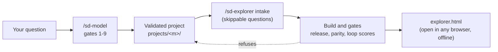

<!-- Generated by engine/build_docs.py from docs/src/README.md. Edit the template, then run `python -I engine/build_docs.py`. -->
# sd-forge

A licence-gated system dynamics (SD) knowledge base with two skills on top of it.

- `/sd-model "<question>"` builds a stock-and-flow model for a question and validates it with `engine/validate.py`, stopping for approval at every gate. No result is shown until every validation test passes.
- `/sd-explorer projects/<m>` turns a validated project into one self-contained `explorer.html`. The page re-runs the validated model live in the browser. Its JavaScript engine is generated from the committed PySD model, and the build proves it matches PySD before the page is written.

Status: built and tested on 2 projects of the same model family only (`bass-b2b-adoption` and `saas-churn-vs-winrate`, which extends it). Anything outside the tested scope fails the build loudly instead of being guessed.

## Pipeline



Gate 10 of `/sd-model` is the `/sd-explorer` step. It starts only after gate 9 is approved.

## Quick start

```bash
python3.12 -m venv .venv && .venv/bin/pip install -r engine/requirements.txt
.venv/bin/python -I engine/validate.py projects/bass-b2b-adoption/validation.toml
.venv/bin/python -I engine/build_explorer.py projects/bass-b2b-adoption
.venv/bin/python -I engine/check_repo.py --require-explorer
.venv/bin/python -I -m pytest engine/tests -q
```

Python 3.11 or 3.12 (PySD may not support newer). The explorer build and the browser tests also need `node` with Playwright and Chromium. Then open `projects/bass-b2b-adoption/explorer.html` in a browser.

## Manuals

- [Quick start guide](docs/QUICKSTART.md): what to type, what you will be asked, how to read the page, what to do if the build refuses.
- [Maintainer and reviewer manual](docs/MANUAL.md): every gate and check with its tolerance, every refusal message, file layout, how to add a project, known limits, troubleshooting, glossary.

## Validated projects

| Project | Validation | Explorer page | Parity with PySD (largest scale-relative difference) | Loop scores |
|---|---|---|---|---|
| `bass-b2b-adoption` | all tests pass | `projects/bass-b2b-adoption/explorer.html` (293 KB) | 0 | live |
| `saas-churn-vs-winrate` | all tests pass (+ `checks.py`) | `projects/saas-churn-vs-winrate/explorer.html` (473 KB) | 7.9e-16 | live |

Each figure above is read from the project's `explorer_parity.json` and `validation_results.json` when this file is generated.

## Repository layout

| Path | Content |
|---|---|
| `raw/` | redistributable source material only, original paths kept, licence files included (`raw/_private/` is gitignored) |
| `library/` | own-words notes: archetypes, units, function compatibility, modelling checklist, validation tests |
| `engine/` | validation (`validate.py`, `loop_detector.py`), explorer build (`build_explorer.py` and the `explorer_*.py` modules, `export_js.py`, `explorer_template/`), repository checks (`check_repo.py`), docs (`build_docs.py`), tests (`tests/`) |
| `projects/<m>/` | one validated model per folder: gate files, `model/` (`.mdl` and PySD `.py`), validation outputs, `summary.md`, and the explorer page |
| `.claude/skills/`, `.claude/commands/` | the `/sd-model` and `/sd-explorer` skills |
| `MANIFEST.csv`, `NEEDS_REVIEW.md` | one row per source file with its licence; sources not downloaded because their licence is unclear |
| `docs/` | these manuals (`docs/src/` holds their templates) |

## Licence policy

- A source is downloaded only if its licence permits redistribution and `commercial_use` is `yes` or `share-alike`.
- `no` (any non-commercial licence) and copyrighted books or papers: a pointer row only, with own-words notes in `library/notes/`.
- `unclear` or unfetchable: not downloaded; listed in `NEEDS_REVIEW.md`.
- Share-alike content (currently `raw/pyworld3`) keeps its licence if reused.

## Key takeaways

- A result is shown only after validation passes, and the explorer page is refused unless the validated model files are the ones on disk.
- The page is a view of the validated model: its engine is checked against PySD on every build, and uncertainty bands appear only where the Monte Carlo run applies.
- Scope is narrow and stated: 2 projects of one model family, headless Chromium only. See the "Known limits" section of the manual for what is not verified.
