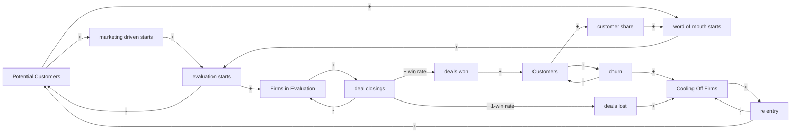

# Gate 3: Dynamic hypothesis and causal loop diagram

**Hypothesis.** Early growth comes from marketing reaching potential customers (B2). Once a base of customers exists, word of mouth (R1) takes over and accelerates growth; it runs through the sales pipeline, so every word-of-mouth evaluation waits a sales cycle and converts only at the win rate. Growth is limited by (a) depletion of the potential pool (B1, B2), (b) churn (B3), and (c) the pipeline and cool-off holding firms out of the pool (B4-B6); lost and churned firms return after a cool-off and can be won later (R2-R5). The long-run plateau sits below the total market.

## Causal loop diagram

(Edges into a stock from its outflow are drawn as `-`. Delay: sales cycle on `Firms in Evaluation`, cool-off on `Cooling Off Firms`.)

## Loops (all 11 are enumerated by `engine/loop_detector.py` and must match this table: test T8)

| Loop | Polarity | Path | Delay inside | Archetype (`library/archetypes.md`) |
|---|---|---|---|---|
| R1 word of mouth | R | Customers -> customer share -> word of mouth starts -> evaluation starts -> Firms in Evaluation -> deal closings -> deals won -> Customers | sales cycle (3-9 mo) | Bass imitation, section 4; growth engine of limits to growth, section 3 |
| B1 saturation via word of mouth | B | Potential -> word of mouth starts -> evaluation starts -> Potential | none | Bass saturation, sections 3-4 |
| B2 saturation via marketing | B | Potential -> marketing driven starts -> evaluation starts -> Potential | none | Bass innovation term, section 4 |
| B3 churn | B | Customers -> churn -> Customers | none | "add churn to get steady state", section 4 |
| B4 pipeline drain (won) | B | Firms in Evaluation -> deal closings -> deals won -> Firms in Evaluation | sales cycle | first-order material delay (section 6 uses delays; not goal seeking) |
| B5 pipeline drain (lost) | B | Firms in Evaluation -> deal closings -> deals lost -> Firms in Evaluation | sales cycle | same |
| B6 cool-off drain | B | Cooling Off Firms -> re entry -> Cooling Off Firms | cool-off (12-36 mo) | first-order material delay |
| R2 lost-deal recycling via marketing | R | Cooling Off -> re entry -> Potential -> marketing starts -> evaluation starts -> Evaluation -> closings -> deals lost -> Cooling Off | sales cycle + cool-off | material recycling in a closed population (no named archetype) |
| R3 lost-deal recycling via word of mouth | R | as R2 through word of mouth starts | sales cycle + cool-off | same |
| R4 churn recycling via marketing | R | Customers -> churn -> Cooling Off -> re entry -> Potential -> marketing starts -> ... -> deals won -> Customers | both | same |
| R5 churn recycling via word of mouth | R | as R4 through word of mouth starts | both | same |

R2-R5 are reinforcing by link polarity, but because the market is closed they recirculate firms rather than create them: they matter because they put lost and churned firms back in front of the sales team.

## MECE check (every variable in exactly one sector; enforced by test T1b, 0 problems)

| Sector | Variables |
|---|---|
| Demand generation | evaluation starts, marketing driven starts, word of mouth starts, customer share, marketing reach rate (+ monthly), word of mouth rate (+ monthly) |
| Market pool | Potential Customers, Cooling Off Firms, re entry, cool off time, total market, initial cooling off firms |
| Sales pipeline | Firms in Evaluation, deal closings, deals won, deals lost, sales cycle time, win rate, initial firms in evaluation |
| Customer base | Customers, churn, churn rate monthly, annual logo churn rate, initial customers |
| Unit conversion | months per year |

27 variables, 27 assignments, no duplicates, no two variables with the same equation.
