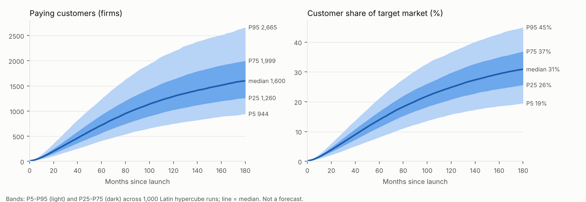

# Summary: adoption of a new B2B software product (Bass diffusion + sales pipeline + churn)

**Bottom line.** Under the stated assumptions, the median path reaches about **720 customers (14% of the target market) at month 60**, with a 90% band of **410-1,243 customers (8-21%)**. Growth is limited **inside 5 years by conversion speed** (win rate, marketing reach), not by market saturation; **churn sets the long-run ceiling** (base-case equilibrium about 46% share, reached only after decades). Improving **win rate** is the best lever in 100% of the 1,000 sampled worlds. This is an uncertainty band from a validated model, **not a forecast**.

Decision informed (assumed, confirm it): which growth lever to fund first over 5 years, and what customer range to plan for at month 60 (`01_problem.md`).

| Month | Customers P5 | P25 | Median | P75 | P95 |
|---|---|---|---|---|---|
| 12 | 57 | 81 | 104 | 131 | 179 |
| 36 | 226 | 322 | 412 | 523 | 733 |
| 60 | 410 | 563 | 719 | 921 | 1,243 |
| 120 | 749 | 1,024 | 1,291 | 1,630 | 2,187 |
| 180 | 944 | 1,260 | 1,600 | 1,999 | 2,665 |

Customer share at month 60: 8.1% / 11.5% / 13.9% / 16.7% / 21.2%; at month 180: 19% / 26% / 31% / 37% / 45%. Months to 10% share: 31 / 38 / 44 / 53 / 73. (N = 1,000 Latin hypercube samples over 8 parameters, `validation_report.md`.)

## What limits growth
| Horizon | Binding limit | Evidence |
|---|---|---|
| Months 0-12 | Marketing reach and sales cycle (pipeline is filling) | Spearman with customers at month 12: marketing reach +0.70, win rate +0.39, sales cycle -0.30 |
| Months 12-80 | Strength of word of mouth through a 21% win rate | Loop R1 dominant months 16-79; win rate Spearman +0.54 with customers at month 60 |
| Months 80+ | Recycling of lost deals and churn | R3 lost-deal recycling dominant most of the time after month 80; churn Spearman -0.65 with share at month 180 |
| Equilibrium | Churn and the share of firms parked in evaluation or cool-off | Base parameters settle near 46% share; with zero churn share approaches 100% (1,200-month deterministic check, `08_policy.md`) |

## Leverage (each lever +20% of base; costs not modelled)
Median gain in customers at month 60: win rate +193, marketing reach +73, word of mouth +51, churn reduction +37, sales cycle reduction +35. Win rate is first in 100% of samples; the order of the last three changes from sample to sample (full ranking stable in 34%). Details: `08_policy.md`.

## Validation (all gating tests passed; `validation_report.md`)
T0 translation identical; T1 units 27/27 consistent; T1b MECE 0 problems; T3 33 extreme cases, 0 failures; T4 dt-halving max change 0.48% (limit 1%); T5 limit case vs closed-form Bass NRMSE 0.13%, peak 15.92 vs 15.80 months; T6 conservation drift 3.0e-15 (limit 1e-6); T7 1,000 samples, 0 failed runs; T8 11 loops found = 11 declared, polarities match.

## Model limits: what this model cannot tell you
- **It cannot forecast your product.** No historical data was used; the parameters are literature and benchmark ranges (`assumptions_register.md`). Replace total market, win rate and churn with your own numbers before using the bands.
- **No revenue, price or ROI.** It counts logos. It cannot say whether a lever pays for itself; the policy ranking is per unit of improvement, not per dollar.
- **No sales or onboarding capacity.** The fast end of the band assumes you can serve every deal (S4).
- **No competitors and no product change.** Win rate and churn are fixed for 15 years (S5); anything after about year 5 is conditional on a static market.
- **Homogeneous firms.** One segment; it cannot compare SMB vs enterprise motions (S1).
- **Re-evaluating firms convert like new ones** (S2). Late growth leans on this; if it is false, months 80+ are optimistic.
- **Bass coefficients come mostly from consumer durables** (S8) and drive the early bands.
- **Vensim compatibility not checked here.** The `.mdl` runs in PySD 3.14.3; opening it in Vensim was not tested (no Vensim in this environment) `[unverified]`.

Licence: original model; no `raw/` content reused; no share-alike source (`sources.md`).
