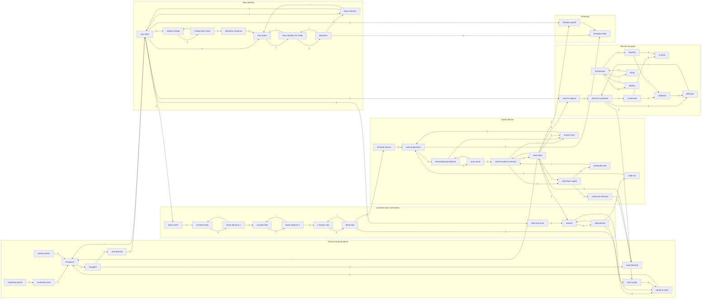

# Gate 3: Dynamic hypothesis and causal loop diagram

**Hypothesis.** A franchised store is four engines on one customer base, and the engines feed each other with delays.
- **Unit sales engine (new and used).** Prospects shop, buy new or used, and leave the pool. New cars come from a
  manufacturer allocation through an order pipeline; used cars come from trade-ins, off-lease returns and auction
  buys through a reconditioning pipeline. Both inventories are stock-management loops with delay (archetype 6); used
  inventory also discounts itself when days-supply runs high.
- **Lease echo.** Lease starts walk through three explicit stages (the lease term) and come out as off-lease used
  supply and a repeat-purchase decision about 36 months later. This is the longest delay in the model.
- **Replacement cycle.** Buyers become owners, owners age into replacement, and a share return to this store.
  That share rises with the size of the service relationship, so fixed ops feeds back into unit sales.
- **Fixed ops engine.** Sales feed the service customer base, which generates repair orders up to a technician-set
  capacity. Overload erodes retention only when optional parameter A is on.

Profit is a separate chain, drawn in the stock-flow gate: gross by line less overhead, commissions and floorplan
interest. **Profit, cash and the levers do not feed back** (gate 2: no reinvestment loop), so no profit variable
appears below and the loop count is structural. What limits profit is expected to move from prospect supply and new
allocation early, to used-supply and replacement-cycle echoes in years 3-5, and to technician capacity later.
That is a hypothesis for the loop-dominance output to test.

## Causal loop diagram

Edges from an outflow into its stock are drawn `-`. Not drawn: constants and the lever schedules (time-driven, no
incoming links); the profit chain, cash and cumulative accumulators (outside every loop); technician and inventory
targets (exogenous); parameter B (a cap on the exogenous inventory target, so no link). `[A]` marks the loop through
`utilisation -> defection`, `[C]` the loop through `allocation response`.

## Loops (48 found; enumerated from the link list above with `networkx.simple_cycles`, the same method `engine/loop_detector.py` uses; T8 must find exactly these)

18 reinforcing, 30 balancing. Ids are assigned by the generating script in order of loop length, so they will change if a link is added.
The machine-readable list is `declared_loops_draft.json`; gate 5 turns it into `[[loops]]` in `validation.toml`.

| Loop | Pol. | Family | Path | Delay inside | Archetype (`library/archetypes.md`) |
|---|---|---|---|---|---|
| B1 | B | first-order adjustment | Lessees Late -> lease end -> Lessees Late | lease term (3 stages) | goal seeking toward 0, s.2 |
| B2 | B | first-order adjustment | Lessees Mid -> lease advance 2 -> Lessees Mid | lease term (3 stages) | goal seeking toward 0, s.2 |
| B3 | B | first-order adjustment | Owners -> replacement -> Owners | ownership period | goal seeking toward 0, s.2 |
| B4 | B | first-order adjustment | Service Customers -> defection -> Service Customers | service tenure | goal seeking toward 0, s.2 |
| B5 | B | first-order adjustment | Trailing New Sales -> trailing change -> Trailing New Sales | allocation memory | goal seeking toward 0, s.2 |
| B6 | B | first-order adjustment | Used Frontline Inventory -> used sales -> Used Frontline Inventory | none | goal seeking toward 0, s.2 |
| B7 | B | lease echo | Lessees Early -> lease advance 1 -> Lessees Early | lease term (3 stages) | none named; delayed reinforcing echo |
| B8 | B | new-vehicle ordering | New Inventory -> new sales -> New Inventory | none | stock management with delay, s.6 |
| B9 | B | new-vehicle ordering | New Vehicles On Order -> deliveries -> New Vehicles On Order | order lead time | stock management with delay, s.6 |
| B10 | B | new-vehicle ordering | New Vehicles On Order -> new orders -> New Vehicles On Order | order lead time | stock management with delay, s.6 |
| B11 | B | technician adjustment | Technicians -> attrition -> Technicians | hiring/attrition time | goal seeking, s.2 |
| B12 | B | technician adjustment | Technicians -> hiring -> Technicians | hiring/attrition time | goal seeking, s.2 |
| B13 | B | used sourcing | Reconditioning Pipeline -> recon done -> Reconditioning Pipeline | reconditioning time | stock management with delay, s.6 |
| B14 | B | used sourcing | Reconditioning Pipeline -> auction buys -> used acquisitions -> Reconditioning Pipeline | reconditioning time | stock management with delay, s.6 |
| B15 | B | wholesale exit | Used Frontline Inventory -> used days supply -> wholesale exits -> Used Frontline Inventory | none | stock management, s.6 |
| B16 | B | new-vehicle ordering | New Inventory -> new orders -> New Vehicles On Order -> deliveries -> New Inventory | order lead time | stock management with delay, s.6 |
| B17 | B | prospect drain | Prospects -> shoppers -> new demand -> new sales -> Prospects | none | limits to growth, s.3 |
| B18 | B | prospect drain | Prospects -> shoppers -> used demand -> used sales -> Prospects | none | limits to growth, s.3 |
| B19 | B | service congestion [A] | Service Customers -> ro demand -> utilisation -> defection -> Service Customers | service tenure | market growth / capacity, s.9 (capacity here is exogenous) |
| B20 | B | used discounting | used days supply -> used price discount -> used demand -> used sales -> used days supply | none | stock management with delay, s.6 |
| R1 | R | wholesale exit | Used Frontline Inventory -> used sales -> used days supply -> wholesale exits -> Used Frontline Inventory | none | stock management, s.6 |
| R2 | R | new-vehicle ordering | New Inventory -> new sales -> new orders -> New Vehicles On Order -> deliveries -> New Inventory | order lead time | stock management with delay, s.6 |
| B21 | B | used discounting | Used Frontline Inventory -> used days supply -> used price discount -> used demand -> used sales -> Used Frontline Inventory | none | stock management with delay, s.6 |
| B22 | B | used sourcing | Reconditioning Pipeline -> recon done -> Used Frontline Inventory -> auction buys -> used acquisitions -> Reconditioning Pipeline | reconditioning time | stock management with delay, s.6 |
| R3 | R | used sourcing | Reconditioning Pipeline -> recon done -> Used Frontline Inventory -> used sales -> auction buys -> used acquisitions -> Reconditioning Pipeline | reconditioning time | stock management with delay, s.6 |
| R4 | R | repeat purchase | Owners -> replacement -> repeat to store -> Prospects -> shoppers -> used demand -> used sales -> Owners | ownership period | none named; reinforcing replacement cycle |
| B23 | B | repeat purchase | Owners -> store loyalty -> repeat to store -> Prospects -> shoppers -> used demand -> used sales -> Owners | ownership period | none named; reinforcing replacement cycle |
| R5 | R | allocation response [C] | New Inventory -> new sales -> trailing change -> Trailing New Sales -> allocation response -> new orders -> New Vehicles On Order -> deliveries -> New Inventory | allocation memory, order lead time | limits to growth, s.3 (R with availability limit) |
| R6 | R | repeat purchase | Owners -> replacement -> repeat to store -> Prospects -> shoppers -> new demand -> new sales -> retail new buys -> Owners | ownership period | none named; reinforcing replacement cycle |
| B24 | B | repeat purchase | Owners -> store loyalty -> repeat to store -> Prospects -> shoppers -> new demand -> new sales -> retail new buys -> Owners | ownership period | none named; reinforcing replacement cycle |
| R7 | R | service loyalty | Prospects -> shoppers -> new demand -> new sales -> service capture -> Service Customers -> store loyalty -> repeat to store -> Prospects | service tenure | none named; reinforcing retention |
| R8 | R | service loyalty | Prospects -> shoppers -> used demand -> used sales -> service capture -> Service Customers -> store loyalty -> repeat to store -> Prospects | service tenure | none named; reinforcing retention |
| R9 | R | used sourcing | Owners -> replacement -> trade ins -> used acquisitions -> Reconditioning Pipeline -> recon done -> Used Frontline Inventory -> used sales -> Owners | reconditioning time, ownership period | stock management with delay, s.6 |
| R10 | R | used discounting | Reconditioning Pipeline -> recon done -> Used Frontline Inventory -> used days supply -> used price discount -> used demand -> used sales -> auction buys -> used acquisitions -> Reconditioning Pipeline | reconditioning time | stock management with delay, s.6 |
| R11 | R | used sourcing | Owners -> replacement -> trade ins -> used acquisitions -> Reconditioning Pipeline -> recon done -> Used Frontline Inventory -> used days supply -> used price discount -> used demand -> used sales -> Owners | reconditioning time, ownership period | stock management with delay, s.6 |
| R12 | R | lease echo | Lessees Early -> lease advance 1 -> Lessees Mid -> lease advance 2 -> Lessees Late -> lease end -> repeat to store -> Prospects -> shoppers -> new demand -> new sales -> lease starts -> Lessees Early | lease term (3 stages) | none named; delayed reinforcing echo |
| B25 | B | prospect drain | Owners -> replacement -> trade ins -> used acquisitions -> Reconditioning Pipeline -> recon done -> Used Frontline Inventory -> used sales -> Prospects -> shoppers -> new demand -> new sales -> retail new buys -> Owners | reconditioning time, ownership period | limits to growth, s.3 |
| B26 | B | prospect drain | Owners -> replacement -> trade ins -> used acquisitions -> Reconditioning Pipeline -> recon done -> Used Frontline Inventory -> used days supply -> used price discount -> used demand -> used sales -> Prospects -> shoppers -> new demand -> new sales -> retail new buys -> Owners | reconditioning time, ownership period | limits to growth, s.3 |
| B27 | B | lease echo | Lessees Early -> lease advance 1 -> Lessees Mid -> lease advance 2 -> Lessees Late -> lease end -> off lease returns -> used acquisitions -> Reconditioning Pipeline -> recon done -> Used Frontline Inventory -> used sales -> Prospects -> shoppers -> new demand -> new sales -> lease starts -> Lessees Early | lease term (3 stages), reconditioning time | none named; delayed reinforcing echo |
| R13 | R | service loyalty | Owners -> replacement -> trade ins -> used acquisitions -> Reconditioning Pipeline -> recon done -> Used Frontline Inventory -> used sales -> service capture -> Service Customers -> store loyalty -> repeat to store -> Prospects -> shoppers -> new demand -> new sales -> retail new buys -> Owners | reconditioning time, ownership period, service tenure | none named; reinforcing retention |
| B28 | B | lease echo | Lessees Early -> lease advance 1 -> Lessees Mid -> lease advance 2 -> Lessees Late -> lease end -> off lease returns -> used acquisitions -> Reconditioning Pipeline -> recon done -> Used Frontline Inventory -> used days supply -> used price discount -> used demand -> used sales -> Prospects -> shoppers -> new demand -> new sales -> lease starts -> Lessees Early | lease term (3 stages), reconditioning time | none named; delayed reinforcing echo |
| R14 | R | lease echo | Lessees Early -> lease advance 1 -> Lessees Mid -> lease advance 2 -> Lessees Late -> lease end -> off lease returns -> used acquisitions -> Reconditioning Pipeline -> recon done -> Used Frontline Inventory -> used sales -> Owners -> replacement -> repeat to store -> Prospects -> shoppers -> new demand -> new sales -> lease starts -> Lessees Early | lease term (3 stages), reconditioning time, ownership period | none named; delayed reinforcing echo |
| B29 | B | lease echo | Lessees Early -> lease advance 1 -> Lessees Mid -> lease advance 2 -> Lessees Late -> lease end -> off lease returns -> used acquisitions -> Reconditioning Pipeline -> recon done -> Used Frontline Inventory -> used sales -> Owners -> store loyalty -> repeat to store -> Prospects -> shoppers -> new demand -> new sales -> lease starts -> Lessees Early | lease term (3 stages), reconditioning time, ownership period | none named; delayed reinforcing echo |
| R15 | R | service loyalty | Owners -> replacement -> trade ins -> used acquisitions -> Reconditioning Pipeline -> recon done -> Used Frontline Inventory -> used days supply -> used price discount -> used demand -> used sales -> service capture -> Service Customers -> store loyalty -> repeat to store -> Prospects -> shoppers -> new demand -> new sales -> retail new buys -> Owners | reconditioning time, ownership period, service tenure | none named; reinforcing retention |
| R16 | R | lease echo | Lessees Early -> lease advance 1 -> Lessees Mid -> lease advance 2 -> Lessees Late -> lease end -> off lease returns -> used acquisitions -> Reconditioning Pipeline -> recon done -> Used Frontline Inventory -> used sales -> service capture -> Service Customers -> store loyalty -> repeat to store -> Prospects -> shoppers -> new demand -> new sales -> lease starts -> Lessees Early | lease term (3 stages), reconditioning time, service tenure | none named; delayed reinforcing echo |
| R17 | R | lease echo | Lessees Early -> lease advance 1 -> Lessees Mid -> lease advance 2 -> Lessees Late -> lease end -> off lease returns -> used acquisitions -> Reconditioning Pipeline -> recon done -> Used Frontline Inventory -> used days supply -> used price discount -> used demand -> used sales -> Owners -> replacement -> repeat to store -> Prospects -> shoppers -> new demand -> new sales -> lease starts -> Lessees Early | lease term (3 stages), reconditioning time, ownership period | none named; delayed reinforcing echo |
| B30 | B | lease echo | Lessees Early -> lease advance 1 -> Lessees Mid -> lease advance 2 -> Lessees Late -> lease end -> off lease returns -> used acquisitions -> Reconditioning Pipeline -> recon done -> Used Frontline Inventory -> used days supply -> used price discount -> used demand -> used sales -> Owners -> store loyalty -> repeat to store -> Prospects -> shoppers -> new demand -> new sales -> lease starts -> Lessees Early | lease term (3 stages), reconditioning time, ownership period | none named; delayed reinforcing echo |
| R18 | R | lease echo | Lessees Early -> lease advance 1 -> Lessees Mid -> lease advance 2 -> Lessees Late -> lease end -> off lease returns -> used acquisitions -> Reconditioning Pipeline -> recon done -> Used Frontline Inventory -> used days supply -> used price discount -> used demand -> used sales -> service capture -> Service Customers -> store loyalty -> repeat to store -> Prospects -> shoppers -> new demand -> new sales -> lease starts -> Lessees Early | lease term (3 stages), reconditioning time, service tenure | none named; delayed reinforcing echo |

**Families.** The 12 families above account for every loop; most are short balancing adjustments (a stock draining
or filling toward a goal). The loops that matter for the four lenses are the long ones:
- **Lease echo (10 loops, R and B mix).** Lease starts -> three lease stages -> off-lease returns -> used inventory ->
  used sales -> service and repeat purchase. They carry the 36-month delay and are the structure behind gate 1
  hypothesis 3.
- **Repeat purchase and service loyalty (8 loops, mostly R).** The path by which owners and the service base return
  as prospects. These are the loops through which fixed ops supports unit sales.
- **New-vehicle ordering (5) and used sourcing (6).** Stock management with delay: the source of hump-and-undershoot
  after a demand shock (gate 1 hypothesis 2).
- **Used discounting (3) and wholesale exit (2).** The balancing carry-cost response (hypothesis 6).
- **Service congestion [A] and allocation response [C].** One loop each, active only when A or C is nonzero.

No archetype from `library/archetypes.md` §7 (shifting the burden) or §8 (depletion) appears. Archetype 9 (market growth /
capacity) appears only as service congestion, because capacity is exogenous (gate 2 item 3).

Polarity check: for each link, "all else equal, if A rises does B rise or fall?" The three non-obvious signs are
`new sales -> Prospects` (-, buying removes a shopper), `Owners -> store loyalty` (-, loyalty is service customers
per owner) and `used sales -> used days supply` (-, faster sales shorten days-supply).

## Conditions for T8 (decided now, carried into gates 5-7)
T8 reads each link's sign from a **base run**; a link that never changes there makes every loop through it
"undetermined" and T8 fails. Consequences:
1. **Smooth functions, no `MIN`/`MAX` kinks.** Availability (inventory limiting sales), used discount, and wholesale
   exit use smooth response curves (for example sales = demand x inventory/(inventory + k)), so every link moves in
   the base run. Hard caps would freeze the link while non-binding.
2. **Base scenario has every engine on:** leases > 0, F&I > 0, service > 0. Lens scenarios are `[[policies]]`.
3. **Parameters A and C at zero freeze `utilisation -> defection` and `allocation response -> new orders`.** The
   loops through them (1 each) would be undetermined at base.

## MECE check (every driver in exactly one sector; T1b enforces it at gate 7)

| Sector | Variables |
|---|---|
| Demand and prospects | Prospects, shoppers, shopping rate (+ monthly), marketing spend, marketing starts, marketing effect per dollar, market entries, market entry rate, new demand, used demand, new share of shoppers, repeat to store, store loyalty |
| New vehicles | New Inventory, New Vehicles On Order, new orders, deliveries, order lead time, new sales, target new days-supply, manufacturer allocation, Trailing New Sales, trailing change, allocation memory, allocation response, allocation response strength (C), availability constant |
| Used vehicles | Used Frontline Inventory, Reconditioning Pipeline, recon done, reconditioning time, used sales, used acquisitions, trade ins, auction buys, off lease returns, wholesale exits, used days supply, target used days-supply, used price discount, discount sensitivity |
| Customer base and leases | Owners, retail new buys, replacement, ownership period, lease share, lease starts, Lessees Early / Mid / Late, lease advance 1 / 2, lease end, lease term |
| Service and parts | Service Customers, service capture, defection, base defection rate, ro demand, visits per customer, ro done, capacity, repairs per technician, utilisation, retention loss when overloaded (A), Technicians, technician target, hiring, attrition, hire time, attrition rate |
| F&I | F&I penetration, F&I gross per contract, chargeback rate, F&I income |
| Financing | Floorplan Debt, floorplan payoff, floorplan rate, advance rate, floorplan interest, credit limit multiple (B) |
| Profit and cost | gross per unit new / used, lease remarketing gain, gross per repair order, parts gross per repair order, commissions, fixed overhead, net profit, Cumulative Net Profit, Cash |
| Scenario levers and shocks | capital allocation schedule, mix target, margin shock, rate shock, demand shock |
| Valuation | discount rate, discounted cash flow, Cumulative Discounted Cash Flow |
| Unit conversion | months per year, days per month |

No two variables mean the same thing: `shoppers` (flow of prospects entering the market, Customer/Month) vs `Prospects`
(stock); `repair order demand` vs `ro done` (demand vs capacity-limited); `used acquisitions` is the sum of its three
sources, not a fourth one. Final names are fixed at gate 5; T1b checks them against the `.mdl`.

## Decision for approval: parameters A and C (as in the worked example, option a)
T8 reads signs from a polarity run: the base run with A and C set to nonzero values inside their ranges,
declared in `validation.toml` as `[loop_check] set = {...}` (gate 5 picks the values). Their bases stay 0 (gate 2).
Scores and the dominance timeline still come from the true base run. This engine feature already exists
(`library/validation_tests.md` T8) and needs no engine change.
Alternative (b): base A and C slightly above 0. Rejected: it would add retention loss and allocation response to the
baseline store without a source.

## Amendment 2026-10-30 (gate 4 approval): 18 loops added; total 66 (27 R, 39 B)
Writing the equations at gate 4 exposed links the gate 3 diagram left out. The approved 48 loops are unchanged
(same variables, same polarity; paths that cross the service ratio are one node longer). The fixes:

| Change | Why |
|---|---|
| `trade ins -> auction buys` (-) and `off lease returns -> auction buys` (-) | Auction buying fills only what trade-ins and off-lease returns do not. Without these links, used inventory would drift above its target as lease volume grows, instead of lease supply displacing auction purchases. |
| `Used Frontline Inventory -> wholesale exits` (+) | Exits scale with the stock as well as with days-supply. Gate 3 had only the days-supply link. Adds the 2-loop `Used Frontline Inventory <-> wholesale exits`. |
| New node `service ratio` (Service Customers +, Owners -) feeding `store loyalty` | Replaces the two direct links to store loyalty, so the ratio is a named, unit-checked variable. |
| New nodes `target used inventory`, `target new inventory` between sales and orders | Targets are variables (days-supply x sales). The direct links `used sales -> auction buys` and `new sales -> new orders` remain. |

Outside every loop (no new loop): source and sink stocks that make vehicle and household counts conserved,
`Inventory at Cost`, `inventory cost released`, `leakage`, `Households Elsewhere`, `Cash` and the profit chain.

The 18 added loops (ids continue the approved numbering; polarity from the link signs, checked by `networkx.simple_cycles` on the final link list):

| Loop | Pol. | Family | Path |
|---|---|---|---|
| B31 | B | wholesale exit | Used Frontline Inventory -> wholesale exits -> Used Frontline Inventory |
| R19 | R | new-vehicle ordering | New Inventory -> new sales -> target new inventory -> new orders -> New Vehicles On Order -> deliveries -> New Inventory |
| R20 | R | used sourcing | Reconditioning Pipeline -> recon done -> Used Frontline Inventory -> used sales -> target used inventory -> auction buys -> used acquisitions -> Reconditioning Pipeline |
| B32 | B | used sourcing | Owners -> replacement -> trade ins -> auction buys -> used acquisitions -> Reconditioning Pipeline -> recon done -> Used Frontline Inventory -> used sales -> Owners |
| R21 | R | used sourcing | Reconditioning Pipeline -> recon done -> Used Frontline Inventory -> used days supply -> used price discount -> used demand -> used sales -> target used inventory -> auction buys -> used acquisitions -> Reconditioning Pipeline |
| B33 | B | used sourcing | Owners -> replacement -> trade ins -> auction buys -> used acquisitions -> Reconditioning Pipeline -> recon done -> Used Frontline Inventory -> used days supply -> used price discount -> used demand -> used sales -> Owners |
| R22 | R | repeat purchase | Owners -> replacement -> trade ins -> auction buys -> used acquisitions -> Reconditioning Pipeline -> recon done -> Used Frontline Inventory -> used sales -> Prospects -> shoppers -> new demand -> new sales -> retail new buys -> Owners |
| R23 | R | repeat purchase | Owners -> replacement -> trade ins -> auction buys -> used acquisitions -> Reconditioning Pipeline -> recon done -> Used Frontline Inventory -> used days supply -> used price discount -> used demand -> used sales -> Prospects -> shoppers -> new demand -> new sales -> retail new buys -> Owners |
| R24 | R | lease echo | Lessees Early -> lease advance 1 -> Lessees Mid -> lease advance 2 -> Lessees Late -> lease end -> off lease returns -> auction buys -> used acquisitions -> Reconditioning Pipeline -> recon done -> Used Frontline Inventory -> used sales -> Prospects -> shoppers -> new demand -> new sales -> lease starts -> Lessees Early |
| B34 | B | service loyalty | Owners -> replacement -> trade ins -> auction buys -> used acquisitions -> Reconditioning Pipeline -> recon done -> Used Frontline Inventory -> used sales -> service capture -> Service Customers -> service ratio -> store loyalty -> repeat to store -> Prospects -> shoppers -> new demand -> new sales -> retail new buys -> Owners |
| R25 | R | lease echo | Lessees Early -> lease advance 1 -> Lessees Mid -> lease advance 2 -> Lessees Late -> lease end -> off lease returns -> auction buys -> used acquisitions -> Reconditioning Pipeline -> recon done -> Used Frontline Inventory -> used days supply -> used price discount -> used demand -> used sales -> Prospects -> shoppers -> new demand -> new sales -> lease starts -> Lessees Early |
| B35 | B | lease echo | Lessees Early -> lease advance 1 -> Lessees Mid -> lease advance 2 -> Lessees Late -> lease end -> off lease returns -> auction buys -> used acquisitions -> Reconditioning Pipeline -> recon done -> Used Frontline Inventory -> used sales -> Owners -> replacement -> repeat to store -> Prospects -> shoppers -> new demand -> new sales -> lease starts -> Lessees Early |
| R26 | R | lease echo | Lessees Early -> lease advance 1 -> Lessees Mid -> lease advance 2 -> Lessees Late -> lease end -> off lease returns -> auction buys -> used acquisitions -> Reconditioning Pipeline -> recon done -> Used Frontline Inventory -> used sales -> Owners -> service ratio -> store loyalty -> repeat to store -> Prospects -> shoppers -> new demand -> new sales -> lease starts -> Lessees Early |
| B36 | B | service loyalty | Owners -> replacement -> trade ins -> auction buys -> used acquisitions -> Reconditioning Pipeline -> recon done -> Used Frontline Inventory -> used days supply -> used price discount -> used demand -> used sales -> service capture -> Service Customers -> service ratio -> store loyalty -> repeat to store -> Prospects -> shoppers -> new demand -> new sales -> retail new buys -> Owners |
| B37 | B | lease echo | Lessees Early -> lease advance 1 -> Lessees Mid -> lease advance 2 -> Lessees Late -> lease end -> off lease returns -> auction buys -> used acquisitions -> Reconditioning Pipeline -> recon done -> Used Frontline Inventory -> used sales -> service capture -> Service Customers -> service ratio -> store loyalty -> repeat to store -> Prospects -> shoppers -> new demand -> new sales -> lease starts -> Lessees Early |
| B38 | B | lease echo | Lessees Early -> lease advance 1 -> Lessees Mid -> lease advance 2 -> Lessees Late -> lease end -> off lease returns -> auction buys -> used acquisitions -> Reconditioning Pipeline -> recon done -> Used Frontline Inventory -> used days supply -> used price discount -> used demand -> used sales -> Owners -> replacement -> repeat to store -> Prospects -> shoppers -> new demand -> new sales -> lease starts -> Lessees Early |
| R27 | R | lease echo | Lessees Early -> lease advance 1 -> Lessees Mid -> lease advance 2 -> Lessees Late -> lease end -> off lease returns -> auction buys -> used acquisitions -> Reconditioning Pipeline -> recon done -> Used Frontline Inventory -> used days supply -> used price discount -> used demand -> used sales -> Owners -> service ratio -> store loyalty -> repeat to store -> Prospects -> shoppers -> new demand -> new sales -> lease starts -> Lessees Early |
| B39 | B | lease echo | Lessees Early -> lease advance 1 -> Lessees Mid -> lease advance 2 -> Lessees Late -> lease end -> off lease returns -> auction buys -> used acquisitions -> Reconditioning Pipeline -> recon done -> Used Frontline Inventory -> used days supply -> used price discount -> used demand -> used sales -> service capture -> Service Customers -> service ratio -> store loyalty -> repeat to store -> Prospects -> shoppers -> new demand -> new sales -> lease starts -> Lessees Early |

Machine-readable full list: `declared_loops_draft.json` (corrected by Amendment 2 below). Gate 5 turns it into `[[loops]]`.
Conditions for T8 from the section above stand, with one clarification: `MIN`/`MAX` appear only as non-negativity guards or supply caps that are inactive in the base run (`auction buys`, `new orders`, `ro done`, and the denominators of `used days supply` and `service ratio`). Their inactive branch leaves every link in the loops live. Gate 7 confirms this from the base run's link scores.

## Amendment 2026-10-30 (gate 4 approval): 18 loops added; total 66 (27 R, 39 B)
Writing the equations at gate 4 exposed links the gate 3 diagram left out. The approved 48 loops are unchanged
(same variables, same polarity; paths that cross the service ratio are one node longer). The fixes:

| Change | Why |
|---|---|
| `trade ins -> auction buys` (-) and `off lease returns -> auction buys` (-) | Auction buying fills only what trade-ins and off-lease returns do not. Without these links, used inventory would drift above its target as lease volume grows, instead of lease supply displacing auction purchases. |
| `Used Frontline Inventory -> wholesale exits` (+) | Exits scale with the stock as well as with days-supply. Gate 3 had only the days-supply link. Adds the 2-loop `Used Frontline Inventory <-> wholesale exits`. |
| New node `service ratio` (Service Customers +, Owners -) feeding `store loyalty` | Replaces the two direct links to store loyalty, so the ratio is a named, unit-checked variable. |
| New nodes `target used inventory`, `target new inventory` between sales and orders | Targets are variables (days-supply x sales). The direct links `used sales -> auction buys` and `new sales -> new orders` remain. |

Outside every loop (no new loop): source and sink stocks that make vehicle and household counts conserved,
`Inventory at Cost`, `inventory cost released`, `leakage`, `Households Elsewhere`, `Cash` and the profit chain.

The 18 added loops (ids continue the approved numbering; polarity from the link signs, checked by `networkx.simple_cycles` on the final link list):

| Loop | Pol. | Family | Path |
|---|---|---|---|
| B31 | B | wholesale exit | Used Frontline Inventory -> wholesale exits -> Used Frontline Inventory |
| R19 | R | new-vehicle ordering | New Inventory -> new sales -> target new inventory -> new orders -> New Vehicles On Order -> deliveries -> New Inventory |
| R20 | R | used sourcing | Reconditioning Pipeline -> recon done -> Used Frontline Inventory -> used sales -> target used inventory -> auction buys -> used acquisitions -> Reconditioning Pipeline |
| B32 | B | used sourcing | Owners -> replacement -> trade ins -> auction buys -> used acquisitions -> Reconditioning Pipeline -> recon done -> Used Frontline Inventory -> used sales -> Owners |
| R21 | R | used sourcing | Reconditioning Pipeline -> recon done -> Used Frontline Inventory -> used days supply -> used price discount -> used demand -> used sales -> target used inventory -> auction buys -> used acquisitions -> Reconditioning Pipeline |
| B33 | B | used sourcing | Owners -> replacement -> trade ins -> auction buys -> used acquisitions -> Reconditioning Pipeline -> recon done -> Used Frontline Inventory -> used days supply -> used price discount -> used demand -> used sales -> Owners |
| R22 | R | repeat purchase | Owners -> replacement -> trade ins -> auction buys -> used acquisitions -> Reconditioning Pipeline -> recon done -> Used Frontline Inventory -> used sales -> Prospects -> shoppers -> new demand -> new sales -> retail new buys -> Owners |
| R23 | R | repeat purchase | Owners -> replacement -> trade ins -> auction buys -> used acquisitions -> Reconditioning Pipeline -> recon done -> Used Frontline Inventory -> used days supply -> used price discount -> used demand -> used sales -> Prospects -> shoppers -> new demand -> new sales -> retail new buys -> Owners |
| R24 | R | lease echo | Lessees Early -> lease advance 1 -> Lessees Mid -> lease advance 2 -> Lessees Late -> lease end -> off lease returns -> auction buys -> used acquisitions -> Reconditioning Pipeline -> recon done -> Used Frontline Inventory -> used sales -> Prospects -> shoppers -> new demand -> new sales -> lease starts -> Lessees Early |
| B34 | B | service loyalty | Owners -> replacement -> trade ins -> auction buys -> used acquisitions -> Reconditioning Pipeline -> recon done -> Used Frontline Inventory -> used sales -> service capture -> Service Customers -> service ratio -> store loyalty -> repeat to store -> Prospects -> shoppers -> new demand -> new sales -> retail new buys -> Owners |
| R25 | R | lease echo | Lessees Early -> lease advance 1 -> Lessees Mid -> lease advance 2 -> Lessees Late -> lease end -> off lease returns -> auction buys -> used acquisitions -> Reconditioning Pipeline -> recon done -> Used Frontline Inventory -> used days supply -> used price discount -> used demand -> used sales -> Prospects -> shoppers -> new demand -> new sales -> lease starts -> Lessees Early |
| B35 | B | lease echo | Lessees Early -> lease advance 1 -> Lessees Mid -> lease advance 2 -> Lessees Late -> lease end -> off lease returns -> auction buys -> used acquisitions -> Reconditioning Pipeline -> recon done -> Used Frontline Inventory -> used sales -> Owners -> replacement -> repeat to store -> Prospects -> shoppers -> new demand -> new sales -> lease starts -> Lessees Early |
| R26 | R | lease echo | Lessees Early -> lease advance 1 -> Lessees Mid -> lease advance 2 -> Lessees Late -> lease end -> off lease returns -> auction buys -> used acquisitions -> Reconditioning Pipeline -> recon done -> Used Frontline Inventory -> used sales -> Owners -> service ratio -> store loyalty -> repeat to store -> Prospects -> shoppers -> new demand -> new sales -> lease starts -> Lessees Early |
| B36 | B | service loyalty | Owners -> replacement -> trade ins -> auction buys -> used acquisitions -> Reconditioning Pipeline -> recon done -> Used Frontline Inventory -> used days supply -> used price discount -> used demand -> used sales -> service capture -> Service Customers -> service ratio -> store loyalty -> repeat to store -> Prospects -> shoppers -> new demand -> new sales -> retail new buys -> Owners |
| B37 | B | lease echo | Lessees Early -> lease advance 1 -> Lessees Mid -> lease advance 2 -> Lessees Late -> lease end -> off lease returns -> auction buys -> used acquisitions -> Reconditioning Pipeline -> recon done -> Used Frontline Inventory -> used sales -> service capture -> Service Customers -> service ratio -> store loyalty -> repeat to store -> Prospects -> shoppers -> new demand -> new sales -> lease starts -> Lessees Early |
| B38 | B | lease echo | Lessees Early -> lease advance 1 -> Lessees Mid -> lease advance 2 -> Lessees Late -> lease end -> off lease returns -> auction buys -> used acquisitions -> Reconditioning Pipeline -> recon done -> Used Frontline Inventory -> used days supply -> used price discount -> used demand -> used sales -> Owners -> replacement -> repeat to store -> Prospects -> shoppers -> new demand -> new sales -> lease starts -> Lessees Early |
| R27 | R | lease echo | Lessees Early -> lease advance 1 -> Lessees Mid -> lease advance 2 -> Lessees Late -> lease end -> off lease returns -> auction buys -> used acquisitions -> Reconditioning Pipeline -> recon done -> Used Frontline Inventory -> used days supply -> used price discount -> used demand -> used sales -> Owners -> service ratio -> store loyalty -> repeat to store -> Prospects -> shoppers -> new demand -> new sales -> lease starts -> Lessees Early |
| B39 | B | lease echo | Lessees Early -> lease advance 1 -> Lessees Mid -> lease advance 2 -> Lessees Late -> lease end -> off lease returns -> auction buys -> used acquisitions -> Reconditioning Pipeline -> recon done -> Used Frontline Inventory -> used days supply -> used price discount -> used demand -> used sales -> service capture -> Service Customers -> service ratio -> store loyalty -> repeat to store -> Prospects -> shoppers -> new demand -> new sales -> lease starts -> Lessees Early |

Machine-readable full list (66 loops): `declared_loops_draft.json`. Gate 5 turns it into `[[loops]]`.
Conditions for T8 from the section above stand, with one clarification: `MIN`/`MAX` appear only as non-negativity guards or supply caps that are inactive in the base run (`auction buys`, `new orders`, `ro done`, and the denominators of `used days supply` and `service ratio`). Their inactive branch leaves every link in the loops live. Gate 7 confirms this from the base run's link scores.

## Amendment 2 2026-10-30 (gate 5): an algebraic loop removed; 67 loops (27 R, 40 B)
**Error in gates 3-4, found while solving the base steady state.** `used days supply` divided by `used sales`, and
`used sales` depends on the discount that days supply sets: `used days supply -> used price discount -> used demand ->
used sales -> used days supply`. That loop contains no stock, so no simulator can solve it (PySD would report
simultaneous equations). I had listed it as loop B20 and approved list item 3 without catching it. The fix is a
stock: `Trailing Used Sales` (information stock, `used sales memory` averaging time), and days supply is measured
against it. Link changes: remove `used sales -> used days supply`; add `used sales -> trailing used change` (+),
`Trailing Used Sales -> trailing used change` (-), `trailing used change -> Trailing Used Sales` (+),
`Trailing Used Sales -> used days supply` (-).

Effect on the loop list, computed by script: 2 loops removed (B20, the algebraic loop, and R1, which crossed the
removed link: `Used Frontline Inventory -> used sales -> used days supply -> wholesale exits`), 3 added. The other 64
keep their ids and polarity. A script (`networkx`) also confirmed no cycle remains among the auxiliaries alone.

| Loop | Pol. | Path |
|---|---|---|
| R28 | R | Trailing Used Sales -> used days supply -> wholesale exits -> Used Frontline Inventory -> used sales -> trailing used change -> Trailing Used Sales |
| B40 | B | Trailing Used Sales -> trailing used change -> Trailing Used Sales |
| B41 | B | Trailing Used Sales -> used days supply -> used price discount -> used demand -> used sales -> trailing used change -> Trailing Used Sales |

Final declared set: **67 loops (27 R, 40 B)**, in `declared_loops_draft.json`.

## Amendment 2026-10-30 (gate 4 approval): 18 loops added; total 66 (27 R, 39 B)
Writing the equations at gate 4 exposed links the gate 3 diagram left out. The approved 48 loops are unchanged
(same variables, same polarity; paths that cross the service ratio are one node longer). The fixes:

| Change | Why |
|---|---|
| `trade ins -> auction buys` (-) and `off lease returns -> auction buys` (-) | Auction buying fills only what trade-ins and off-lease returns do not. Without these links, used inventory would drift above its target as lease volume grows, instead of lease supply displacing auction purchases. |
| `Used Frontline Inventory -> wholesale exits` (+) | Exits scale with the stock as well as with days-supply. Gate 3 had only the days-supply link. Adds the 2-loop `Used Frontline Inventory <-> wholesale exits`. |
| New node `service ratio` (Service Customers +, Owners -) feeding `store loyalty` | Replaces the two direct links to store loyalty, so the ratio is a named, unit-checked variable. |
| New nodes `target used inventory`, `target new inventory` between sales and orders | Targets are variables (days-supply x sales). The direct links `used sales -> auction buys` and `new sales -> new orders` remain. |

Outside every loop (no new loop): source and sink stocks that make vehicle and household counts conserved,
`Inventory at Cost`, `inventory cost released`, `leakage`, `Households Elsewhere`, `Cash` and the profit chain.

The 18 added loops (ids continue the approved numbering; polarity from the link signs, checked by `networkx.simple_cycles` on the final link list):

| Loop | Pol. | Family | Path |
|---|---|---|---|
| B31 | B | wholesale exit | Used Frontline Inventory -> wholesale exits -> Used Frontline Inventory |
| R19 | R | new-vehicle ordering | New Inventory -> new sales -> target new inventory -> new orders -> New Vehicles On Order -> deliveries -> New Inventory |
| R20 | R | used sourcing | Reconditioning Pipeline -> recon done -> Used Frontline Inventory -> used sales -> target used inventory -> auction buys -> used acquisitions -> Reconditioning Pipeline |
| B32 | B | used sourcing | Owners -> replacement -> trade ins -> auction buys -> used acquisitions -> Reconditioning Pipeline -> recon done -> Used Frontline Inventory -> used sales -> Owners |
| R21 | R | used sourcing | Reconditioning Pipeline -> recon done -> Used Frontline Inventory -> used days supply -> used price discount -> used demand -> used sales -> target used inventory -> auction buys -> used acquisitions -> Reconditioning Pipeline |
| B33 | B | used sourcing | Owners -> replacement -> trade ins -> auction buys -> used acquisitions -> Reconditioning Pipeline -> recon done -> Used Frontline Inventory -> used days supply -> used price discount -> used demand -> used sales -> Owners |
| R22 | R | repeat purchase | Owners -> replacement -> trade ins -> auction buys -> used acquisitions -> Reconditioning Pipeline -> recon done -> Used Frontline Inventory -> used sales -> Prospects -> shoppers -> new demand -> new sales -> retail new buys -> Owners |
| R23 | R | repeat purchase | Owners -> replacement -> trade ins -> auction buys -> used acquisitions -> Reconditioning Pipeline -> recon done -> Used Frontline Inventory -> used days supply -> used price discount -> used demand -> used sales -> Prospects -> shoppers -> new demand -> new sales -> retail new buys -> Owners |
| R24 | R | lease echo | Lessees Early -> lease advance 1 -> Lessees Mid -> lease advance 2 -> Lessees Late -> lease end -> off lease returns -> auction buys -> used acquisitions -> Reconditioning Pipeline -> recon done -> Used Frontline Inventory -> used sales -> Prospects -> shoppers -> new demand -> new sales -> lease starts -> Lessees Early |
| B34 | B | service loyalty | Owners -> replacement -> trade ins -> auction buys -> used acquisitions -> Reconditioning Pipeline -> recon done -> Used Frontline Inventory -> used sales -> service capture -> Service Customers -> service ratio -> store loyalty -> repeat to store -> Prospects -> shoppers -> new demand -> new sales -> retail new buys -> Owners |
| R25 | R | lease echo | Lessees Early -> lease advance 1 -> Lessees Mid -> lease advance 2 -> Lessees Late -> lease end -> off lease returns -> auction buys -> used acquisitions -> Reconditioning Pipeline -> recon done -> Used Frontline Inventory -> used days supply -> used price discount -> used demand -> used sales -> Prospects -> shoppers -> new demand -> new sales -> lease starts -> Lessees Early |
| B35 | B | lease echo | Lessees Early -> lease advance 1 -> Lessees Mid -> lease advance 2 -> Lessees Late -> lease end -> off lease returns -> auction buys -> used acquisitions -> Reconditioning Pipeline -> recon done -> Used Frontline Inventory -> used sales -> Owners -> replacement -> repeat to store -> Prospects -> shoppers -> new demand -> new sales -> lease starts -> Lessees Early |
| R26 | R | lease echo | Lessees Early -> lease advance 1 -> Lessees Mid -> lease advance 2 -> Lessees Late -> lease end -> off lease returns -> auction buys -> used acquisitions -> Reconditioning Pipeline -> recon done -> Used Frontline Inventory -> used sales -> Owners -> service ratio -> store loyalty -> repeat to store -> Prospects -> shoppers -> new demand -> new sales -> lease starts -> Lessees Early |
| B36 | B | service loyalty | Owners -> replacement -> trade ins -> auction buys -> used acquisitions -> Reconditioning Pipeline -> recon done -> Used Frontline Inventory -> used days supply -> used price discount -> used demand -> used sales -> service capture -> Service Customers -> service ratio -> store loyalty -> repeat to store -> Prospects -> shoppers -> new demand -> new sales -> retail new buys -> Owners |
| B37 | B | lease echo | Lessees Early -> lease advance 1 -> Lessees Mid -> lease advance 2 -> Lessees Late -> lease end -> off lease returns -> auction buys -> used acquisitions -> Reconditioning Pipeline -> recon done -> Used Frontline Inventory -> used sales -> service capture -> Service Customers -> service ratio -> store loyalty -> repeat to store -> Prospects -> shoppers -> new demand -> new sales -> lease starts -> Lessees Early |
| B38 | B | lease echo | Lessees Early -> lease advance 1 -> Lessees Mid -> lease advance 2 -> Lessees Late -> lease end -> off lease returns -> auction buys -> used acquisitions -> Reconditioning Pipeline -> recon done -> Used Frontline Inventory -> used days supply -> used price discount -> used demand -> used sales -> Owners -> replacement -> repeat to store -> Prospects -> shoppers -> new demand -> new sales -> lease starts -> Lessees Early |
| R27 | R | lease echo | Lessees Early -> lease advance 1 -> Lessees Mid -> lease advance 2 -> Lessees Late -> lease end -> off lease returns -> auction buys -> used acquisitions -> Reconditioning Pipeline -> recon done -> Used Frontline Inventory -> used days supply -> used price discount -> used demand -> used sales -> Owners -> service ratio -> store loyalty -> repeat to store -> Prospects -> shoppers -> new demand -> new sales -> lease starts -> Lessees Early |
| B39 | B | lease echo | Lessees Early -> lease advance 1 -> Lessees Mid -> lease advance 2 -> Lessees Late -> lease end -> off lease returns -> auction buys -> used acquisitions -> Reconditioning Pipeline -> recon done -> Used Frontline Inventory -> used days supply -> used price discount -> used demand -> used sales -> service capture -> Service Customers -> service ratio -> store loyalty -> repeat to store -> Prospects -> shoppers -> new demand -> new sales -> lease starts -> Lessees Early |

Machine-readable full list (66 loops): `declared_loops_draft.json`. Gate 5 turns it into `[[loops]]`.
Conditions for T8 from the section above stand, with one clarification: `MIN`/`MAX` appear only as non-negativity guards or supply caps that are inactive in the base run (`auction buys`, `new orders`, `ro done`, and the denominators of `used days supply` and `service ratio`). Their inactive branch leaves every link in the loops live. Gate 7 confirms this from the base run's link scores.

## Amendment 2026-10-30 (gate 4 approval): 18 loops added; total 66 (27 R, 39 B)
Writing the equations at gate 4 exposed links the gate 3 diagram left out. The approved 48 loops are unchanged
(same variables, same polarity; paths that cross the service ratio are one node longer). The fixes:

| Change | Why |
|---|---|
| `trade ins -> auction buys` (-) and `off lease returns -> auction buys` (-) | Auction buying fills only what trade-ins and off-lease returns do not. Without these links, used inventory would drift above its target as lease volume grows, instead of lease supply displacing auction purchases. |
| `Used Frontline Inventory -> wholesale exits` (+) | Exits scale with the stock as well as with days-supply. Gate 3 had only the days-supply link. Adds the 2-loop `Used Frontline Inventory <-> wholesale exits`. |
| New node `service ratio` (Service Customers +, Owners -) feeding `store loyalty` | Replaces the two direct links to store loyalty, so the ratio is a named, unit-checked variable. |
| New nodes `target used inventory`, `target new inventory` between sales and orders | Targets are variables (days-supply x sales). The direct links `used sales -> auction buys` and `new sales -> new orders` remain. |

Outside every loop (no new loop): source and sink stocks that make vehicle and household counts conserved,
`Inventory at Cost`, `inventory cost released`, `leakage`, `Households Elsewhere`, `Cash` and the profit chain.

The 18 added loops (ids continue the approved numbering; polarity from the link signs, checked by `networkx.simple_cycles` on the final link list):

| Loop | Pol. | Family | Path |
|---|---|---|---|
| B31 | B | wholesale exit | Used Frontline Inventory -> wholesale exits -> Used Frontline Inventory |
| R19 | R | new-vehicle ordering | New Inventory -> new sales -> target new inventory -> new orders -> New Vehicles On Order -> deliveries -> New Inventory |
| R20 | R | used sourcing | Reconditioning Pipeline -> recon done -> Used Frontline Inventory -> used sales -> target used inventory -> auction buys -> used acquisitions -> Reconditioning Pipeline |
| B32 | B | used sourcing | Owners -> replacement -> trade ins -> auction buys -> used acquisitions -> Reconditioning Pipeline -> recon done -> Used Frontline Inventory -> used sales -> Owners |
| R21 | R | used sourcing | Reconditioning Pipeline -> recon done -> Used Frontline Inventory -> used days supply -> used price discount -> used demand -> used sales -> target used inventory -> auction buys -> used acquisitions -> Reconditioning Pipeline |
| B33 | B | used sourcing | Owners -> replacement -> trade ins -> auction buys -> used acquisitions -> Reconditioning Pipeline -> recon done -> Used Frontline Inventory -> used days supply -> used price discount -> used demand -> used sales -> Owners |
| R22 | R | repeat purchase | Owners -> replacement -> trade ins -> auction buys -> used acquisitions -> Reconditioning Pipeline -> recon done -> Used Frontline Inventory -> used sales -> Prospects -> shoppers -> new demand -> new sales -> retail new buys -> Owners |
| R23 | R | repeat purchase | Owners -> replacement -> trade ins -> auction buys -> used acquisitions -> Reconditioning Pipeline -> recon done -> Used Frontline Inventory -> used days supply -> used price discount -> used demand -> used sales -> Prospects -> shoppers -> new demand -> new sales -> retail new buys -> Owners |
| R24 | R | lease echo | Lessees Early -> lease advance 1 -> Lessees Mid -> lease advance 2 -> Lessees Late -> lease end -> off lease returns -> auction buys -> used acquisitions -> Reconditioning Pipeline -> recon done -> Used Frontline Inventory -> used sales -> Prospects -> shoppers -> new demand -> new sales -> lease starts -> Lessees Early |
| B34 | B | service loyalty | Owners -> replacement -> trade ins -> auction buys -> used acquisitions -> Reconditioning Pipeline -> recon done -> Used Frontline Inventory -> used sales -> service capture -> Service Customers -> service ratio -> store loyalty -> repeat to store -> Prospects -> shoppers -> new demand -> new sales -> retail new buys -> Owners |
| R25 | R | lease echo | Lessees Early -> lease advance 1 -> Lessees Mid -> lease advance 2 -> Lessees Late -> lease end -> off lease returns -> auction buys -> used acquisitions -> Reconditioning Pipeline -> recon done -> Used Frontline Inventory -> used days supply -> used price discount -> used demand -> used sales -> Prospects -> shoppers -> new demand -> new sales -> lease starts -> Lessees Early |
| B35 | B | lease echo | Lessees Early -> lease advance 1 -> Lessees Mid -> lease advance 2 -> Lessees Late -> lease end -> off lease returns -> auction buys -> used acquisitions -> Reconditioning Pipeline -> recon done -> Used Frontline Inventory -> used sales -> Owners -> replacement -> repeat to store -> Prospects -> shoppers -> new demand -> new sales -> lease starts -> Lessees Early |
| R26 | R | lease echo | Lessees Early -> lease advance 1 -> Lessees Mid -> lease advance 2 -> Lessees Late -> lease end -> off lease returns -> auction buys -> used acquisitions -> Reconditioning Pipeline -> recon done -> Used Frontline Inventory -> used sales -> Owners -> service ratio -> store loyalty -> repeat to store -> Prospects -> shoppers -> new demand -> new sales -> lease starts -> Lessees Early |
| B36 | B | service loyalty | Owners -> replacement -> trade ins -> auction buys -> used acquisitions -> Reconditioning Pipeline -> recon done -> Used Frontline Inventory -> used days supply -> used price discount -> used demand -> used sales -> service capture -> Service Customers -> service ratio -> store loyalty -> repeat to store -> Prospects -> shoppers -> new demand -> new sales -> retail new buys -> Owners |
| B37 | B | lease echo | Lessees Early -> lease advance 1 -> Lessees Mid -> lease advance 2 -> Lessees Late -> lease end -> off lease returns -> auction buys -> used acquisitions -> Reconditioning Pipeline -> recon done -> Used Frontline Inventory -> used sales -> service capture -> Service Customers -> service ratio -> store loyalty -> repeat to store -> Prospects -> shoppers -> new demand -> new sales -> lease starts -> Lessees Early |
| B38 | B | lease echo | Lessees Early -> lease advance 1 -> Lessees Mid -> lease advance 2 -> Lessees Late -> lease end -> off lease returns -> auction buys -> used acquisitions -> Reconditioning Pipeline -> recon done -> Used Frontline Inventory -> used days supply -> used price discount -> used demand -> used sales -> Owners -> replacement -> repeat to store -> Prospects -> shoppers -> new demand -> new sales -> lease starts -> Lessees Early |
| R27 | R | lease echo | Lessees Early -> lease advance 1 -> Lessees Mid -> lease advance 2 -> Lessees Late -> lease end -> off lease returns -> auction buys -> used acquisitions -> Reconditioning Pipeline -> recon done -> Used Frontline Inventory -> used days supply -> used price discount -> used demand -> used sales -> Owners -> service ratio -> store loyalty -> repeat to store -> Prospects -> shoppers -> new demand -> new sales -> lease starts -> Lessees Early |
| B39 | B | lease echo | Lessees Early -> lease advance 1 -> Lessees Mid -> lease advance 2 -> Lessees Late -> lease end -> off lease returns -> auction buys -> used acquisitions -> Reconditioning Pipeline -> recon done -> Used Frontline Inventory -> used days supply -> used price discount -> used demand -> used sales -> service capture -> Service Customers -> service ratio -> store loyalty -> repeat to store -> Prospects -> shoppers -> new demand -> new sales -> lease starts -> Lessees Early |

Machine-readable full list (66 loops): `declared_loops_draft.json`. Gate 5 turns it into `[[loops]]`.
Conditions for T8 from the section above stand, with one clarification: `MIN`/`MAX` appear only as non-negativity guards or supply caps that are inactive in the base run (`auction buys`, `new orders`, `ro done`, and the denominators of `used days supply` and `service ratio`). Their inactive branch leaves every link in the loops live. Gate 7 confirms this from the base run's link scores.

## Amendment 2026-10-30 (gate 4 approval): 18 loops added; total 66 (27 R, 39 B)
Writing the equations at gate 4 exposed links the gate 3 diagram left out. The approved 48 loops are unchanged
(same variables, same polarity; paths that cross the service ratio are one node longer). The fixes:

| Change | Why |
|---|---|
| `trade ins -> auction buys` (-) and `off lease returns -> auction buys` (-) | Auction buying fills only what trade-ins and off-lease returns do not. Without these links, used inventory would drift above its target as lease volume grows, instead of lease supply displacing auction purchases. |
| `Used Frontline Inventory -> wholesale exits` (+) | Exits scale with the stock as well as with days-supply. Gate 3 had only the days-supply link. Adds the 2-loop `Used Frontline Inventory <-> wholesale exits`. |
| New node `service ratio` (Service Customers +, Owners -) feeding `store loyalty` | Replaces the two direct links to store loyalty, so the ratio is a named, unit-checked variable. |
| New nodes `target used inventory`, `target new inventory` between sales and orders | Targets are variables (days-supply x sales). The direct links `used sales -> auction buys` and `new sales -> new orders` remain. |

Outside every loop (no new loop): source and sink stocks that make vehicle and household counts conserved,
`Inventory at Cost`, `inventory cost released`, `leakage`, `Households Elsewhere`, `Cash` and the profit chain.

The 18 added loops (ids continue the approved numbering; polarity from the link signs, checked by `networkx.simple_cycles` on the final link list):

| Loop | Pol. | Family | Path |
|---|---|---|---|
| B31 | B | wholesale exit | Used Frontline Inventory -> wholesale exits -> Used Frontline Inventory |
| R19 | R | new-vehicle ordering | New Inventory -> new sales -> target new inventory -> new orders -> New Vehicles On Order -> deliveries -> New Inventory |
| R20 | R | used sourcing | Reconditioning Pipeline -> recon done -> Used Frontline Inventory -> used sales -> target used inventory -> auction buys -> used acquisitions -> Reconditioning Pipeline |
| B32 | B | used sourcing | Owners -> replacement -> trade ins -> auction buys -> used acquisitions -> Reconditioning Pipeline -> recon done -> Used Frontline Inventory -> used sales -> Owners |
| R21 | R | used sourcing | Reconditioning Pipeline -> recon done -> Used Frontline Inventory -> used days supply -> used price discount -> used demand -> used sales -> target used inventory -> auction buys -> used acquisitions -> Reconditioning Pipeline |
| B33 | B | used sourcing | Owners -> replacement -> trade ins -> auction buys -> used acquisitions -> Reconditioning Pipeline -> recon done -> Used Frontline Inventory -> used days supply -> used price discount -> used demand -> used sales -> Owners |
| R22 | R | repeat purchase | Owners -> replacement -> trade ins -> auction buys -> used acquisitions -> Reconditioning Pipeline -> recon done -> Used Frontline Inventory -> used sales -> Prospects -> shoppers -> new demand -> new sales -> retail new buys -> Owners |
| R23 | R | repeat purchase | Owners -> replacement -> trade ins -> auction buys -> used acquisitions -> Reconditioning Pipeline -> recon done -> Used Frontline Inventory -> used days supply -> used price discount -> used demand -> used sales -> Prospects -> shoppers -> new demand -> new sales -> retail new buys -> Owners |
| R24 | R | lease echo | Lessees Early -> lease advance 1 -> Lessees Mid -> lease advance 2 -> Lessees Late -> lease end -> off lease returns -> auction buys -> used acquisitions -> Reconditioning Pipeline -> recon done -> Used Frontline Inventory -> used sales -> Prospects -> shoppers -> new demand -> new sales -> lease starts -> Lessees Early |
| B34 | B | service loyalty | Owners -> replacement -> trade ins -> auction buys -> used acquisitions -> Reconditioning Pipeline -> recon done -> Used Frontline Inventory -> used sales -> service capture -> Service Customers -> service ratio -> store loyalty -> repeat to store -> Prospects -> shoppers -> new demand -> new sales -> retail new buys -> Owners |
| R25 | R | lease echo | Lessees Early -> lease advance 1 -> Lessees Mid -> lease advance 2 -> Lessees Late -> lease end -> off lease returns -> auction buys -> used acquisitions -> Reconditioning Pipeline -> recon done -> Used Frontline Inventory -> used days supply -> used price discount -> used demand -> used sales -> Prospects -> shoppers -> new demand -> new sales -> lease starts -> Lessees Early |
| B35 | B | lease echo | Lessees Early -> lease advance 1 -> Lessees Mid -> lease advance 2 -> Lessees Late -> lease end -> off lease returns -> auction buys -> used acquisitions -> Reconditioning Pipeline -> recon done -> Used Frontline Inventory -> used sales -> Owners -> replacement -> repeat to store -> Prospects -> shoppers -> new demand -> new sales -> lease starts -> Lessees Early |
| R26 | R | lease echo | Lessees Early -> lease advance 1 -> Lessees Mid -> lease advance 2 -> Lessees Late -> lease end -> off lease returns -> auction buys -> used acquisitions -> Reconditioning Pipeline -> recon done -> Used Frontline Inventory -> used sales -> Owners -> service ratio -> store loyalty -> repeat to store -> Prospects -> shoppers -> new demand -> new sales -> lease starts -> Lessees Early |
| B36 | B | service loyalty | Owners -> replacement -> trade ins -> auction buys -> used acquisitions -> Reconditioning Pipeline -> recon done -> Used Frontline Inventory -> used days supply -> used price discount -> used demand -> used sales -> service capture -> Service Customers -> service ratio -> store loyalty -> repeat to store -> Prospects -> shoppers -> new demand -> new sales -> retail new buys -> Owners |
| B37 | B | lease echo | Lessees Early -> lease advance 1 -> Lessees Mid -> lease advance 2 -> Lessees Late -> lease end -> off lease returns -> auction buys -> used acquisitions -> Reconditioning Pipeline -> recon done -> Used Frontline Inventory -> used sales -> service capture -> Service Customers -> service ratio -> store loyalty -> repeat to store -> Prospects -> shoppers -> new demand -> new sales -> lease starts -> Lessees Early |
| B38 | B | lease echo | Lessees Early -> lease advance 1 -> Lessees Mid -> lease advance 2 -> Lessees Late -> lease end -> off lease returns -> auction buys -> used acquisitions -> Reconditioning Pipeline -> recon done -> Used Frontline Inventory -> used days supply -> used price discount -> used demand -> used sales -> Owners -> replacement -> repeat to store -> Prospects -> shoppers -> new demand -> new sales -> lease starts -> Lessees Early |
| R27 | R | lease echo | Lessees Early -> lease advance 1 -> Lessees Mid -> lease advance 2 -> Lessees Late -> lease end -> off lease returns -> auction buys -> used acquisitions -> Reconditioning Pipeline -> recon done -> Used Frontline Inventory -> used days supply -> used price discount -> used demand -> used sales -> Owners -> service ratio -> store loyalty -> repeat to store -> Prospects -> shoppers -> new demand -> new sales -> lease starts -> Lessees Early |
| B39 | B | lease echo | Lessees Early -> lease advance 1 -> Lessees Mid -> lease advance 2 -> Lessees Late -> lease end -> off lease returns -> auction buys -> used acquisitions -> Reconditioning Pipeline -> recon done -> Used Frontline Inventory -> used days supply -> used price discount -> used demand -> used sales -> service capture -> Service Customers -> service ratio -> store loyalty -> repeat to store -> Prospects -> shoppers -> new demand -> new sales -> lease starts -> Lessees Early |

Machine-readable full list (66 loops): `declared_loops_draft.json`. Gate 5 turns it into `[[loops]]`.
Conditions for T8 from the section above stand, with one clarification: `MIN`/`MAX` appear only as non-negativity guards or supply caps that are inactive in the base run (`auction buys`, `new orders`, `ro done`, and the denominators of `used days supply` and `service ratio`). Their inactive branch leaves every link in the loops live. Gate 7 confirms this from the base run's link scores.

## Amendment 2026-10-30 (gate 4 approval): 18 loops added; total 66 (27 R, 39 B)
Writing the equations at gate 4 exposed links the gate 3 diagram left out. The approved 48 loops are unchanged
(same variables, same polarity; paths that cross the service ratio are one node longer). The fixes:

| Change | Why |
|---|---|
| `trade ins -> auction buys` (-) and `off lease returns -> auction buys` (-) | Auction buying fills only what trade-ins and off-lease returns do not. Without these links, used inventory would drift above its target as lease volume grows, instead of lease supply displacing auction purchases. |
| `Used Frontline Inventory -> wholesale exits` (+) | Exits scale with the stock as well as with days-supply. Gate 3 had only the days-supply link. Adds the 2-loop `Used Frontline Inventory <-> wholesale exits`. |
| New node `service ratio` (Service Customers +, Owners -) feeding `store loyalty` | Replaces the two direct links to store loyalty, so the ratio is a named, unit-checked variable. |
| New nodes `target used inventory`, `target new inventory` between sales and orders | Targets are variables (days-supply x sales). The direct links `used sales -> auction buys` and `new sales -> new orders` remain. |

Outside every loop (no new loop): source and sink stocks that make vehicle and household counts conserved,
`Inventory at Cost`, `inventory cost released`, `leakage`, `Households Elsewhere`, `Cash` and the profit chain.

The 18 added loops (ids continue the approved numbering; polarity from the link signs, checked by `networkx.simple_cycles` on the final link list):

| Loop | Pol. | Family | Path |
|---|---|---|---|
| B31 | B | wholesale exit | Used Frontline Inventory -> wholesale exits -> Used Frontline Inventory |
| R19 | R | new-vehicle ordering | New Inventory -> new sales -> target new inventory -> new orders -> New Vehicles On Order -> deliveries -> New Inventory |
| R20 | R | used sourcing | Reconditioning Pipeline -> recon done -> Used Frontline Inventory -> used sales -> target used inventory -> auction buys -> used acquisitions -> Reconditioning Pipeline |
| B32 | B | used sourcing | Owners -> replacement -> trade ins -> auction buys -> used acquisitions -> Reconditioning Pipeline -> recon done -> Used Frontline Inventory -> used sales -> Owners |
| R21 | R | used sourcing | Reconditioning Pipeline -> recon done -> Used Frontline Inventory -> used days supply -> used price discount -> used demand -> used sales -> target used inventory -> auction buys -> used acquisitions -> Reconditioning Pipeline |
| B33 | B | used sourcing | Owners -> replacement -> trade ins -> auction buys -> used acquisitions -> Reconditioning Pipeline -> recon done -> Used Frontline Inventory -> used days supply -> used price discount -> used demand -> used sales -> Owners |
| R22 | R | repeat purchase | Owners -> replacement -> trade ins -> auction buys -> used acquisitions -> Reconditioning Pipeline -> recon done -> Used Frontline Inventory -> used sales -> Prospects -> shoppers -> new demand -> new sales -> retail new buys -> Owners |
| R23 | R | repeat purchase | Owners -> replacement -> trade ins -> auction buys -> used acquisitions -> Reconditioning Pipeline -> recon done -> Used Frontline Inventory -> used days supply -> used price discount -> used demand -> used sales -> Prospects -> shoppers -> new demand -> new sales -> retail new buys -> Owners |
| R24 | R | lease echo | Lessees Early -> lease advance 1 -> Lessees Mid -> lease advance 2 -> Lessees Late -> lease end -> off lease returns -> auction buys -> used acquisitions -> Reconditioning Pipeline -> recon done -> Used Frontline Inventory -> used sales -> Prospects -> shoppers -> new demand -> new sales -> lease starts -> Lessees Early |
| B34 | B | service loyalty | Owners -> replacement -> trade ins -> auction buys -> used acquisitions -> Reconditioning Pipeline -> recon done -> Used Frontline Inventory -> used sales -> service capture -> Service Customers -> service ratio -> store loyalty -> repeat to store -> Prospects -> shoppers -> new demand -> new sales -> retail new buys -> Owners |
| R25 | R | lease echo | Lessees Early -> lease advance 1 -> Lessees Mid -> lease advance 2 -> Lessees Late -> lease end -> off lease returns -> auction buys -> used acquisitions -> Reconditioning Pipeline -> recon done -> Used Frontline Inventory -> used days supply -> used price discount -> used demand -> used sales -> Prospects -> shoppers -> new demand -> new sales -> lease starts -> Lessees Early |
| B35 | B | lease echo | Lessees Early -> lease advance 1 -> Lessees Mid -> lease advance 2 -> Lessees Late -> lease end -> off lease returns -> auction buys -> used acquisitions -> Reconditioning Pipeline -> recon done -> Used Frontline Inventory -> used sales -> Owners -> replacement -> repeat to store -> Prospects -> shoppers -> new demand -> new sales -> lease starts -> Lessees Early |
| R26 | R | lease echo | Lessees Early -> lease advance 1 -> Lessees Mid -> lease advance 2 -> Lessees Late -> lease end -> off lease returns -> auction buys -> used acquisitions -> Reconditioning Pipeline -> recon done -> Used Frontline Inventory -> used sales -> Owners -> service ratio -> store loyalty -> repeat to store -> Prospects -> shoppers -> new demand -> new sales -> lease starts -> Lessees Early |
| B36 | B | service loyalty | Owners -> replacement -> trade ins -> auction buys -> used acquisitions -> Reconditioning Pipeline -> recon done -> Used Frontline Inventory -> used days supply -> used price discount -> used demand -> used sales -> service capture -> Service Customers -> service ratio -> store loyalty -> repeat to store -> Prospects -> shoppers -> new demand -> new sales -> retail new buys -> Owners |
| B37 | B | lease echo | Lessees Early -> lease advance 1 -> Lessees Mid -> lease advance 2 -> Lessees Late -> lease end -> off lease returns -> auction buys -> used acquisitions -> Reconditioning Pipeline -> recon done -> Used Frontline Inventory -> used sales -> service capture -> Service Customers -> service ratio -> store loyalty -> repeat to store -> Prospects -> shoppers -> new demand -> new sales -> lease starts -> Lessees Early |
| B38 | B | lease echo | Lessees Early -> lease advance 1 -> Lessees Mid -> lease advance 2 -> Lessees Late -> lease end -> off lease returns -> auction buys -> used acquisitions -> Reconditioning Pipeline -> recon done -> Used Frontline Inventory -> used days supply -> used price discount -> used demand -> used sales -> Owners -> replacement -> repeat to store -> Prospects -> shoppers -> new demand -> new sales -> lease starts -> Lessees Early |
| R27 | R | lease echo | Lessees Early -> lease advance 1 -> Lessees Mid -> lease advance 2 -> Lessees Late -> lease end -> off lease returns -> auction buys -> used acquisitions -> Reconditioning Pipeline -> recon done -> Used Frontline Inventory -> used days supply -> used price discount -> used demand -> used sales -> Owners -> service ratio -> store loyalty -> repeat to store -> Prospects -> shoppers -> new demand -> new sales -> lease starts -> Lessees Early |
| B39 | B | lease echo | Lessees Early -> lease advance 1 -> Lessees Mid -> lease advance 2 -> Lessees Late -> lease end -> off lease returns -> auction buys -> used acquisitions -> Reconditioning Pipeline -> recon done -> Used Frontline Inventory -> used days supply -> used price discount -> used demand -> used sales -> service capture -> Service Customers -> service ratio -> store loyalty -> repeat to store -> Prospects -> shoppers -> new demand -> new sales -> lease starts -> Lessees Early |

Machine-readable full list (66 loops): `declared_loops_draft.json`. Gate 5 turns it into `[[loops]]`.
Conditions for T8 from the section above stand, with one clarification: `MIN`/`MAX` appear only as non-negativity guards or supply caps that are inactive in the base run (`auction buys`, `new orders`, `ro done`, and the denominators of `used days supply` and `service ratio`). Their inactive branch leaves every link in the loops live. Gate 7 confirms this from the base run's link scores.

## Amendment 2026-10-30 (gate 4 approval): 18 loops added; total 66 (27 R, 39 B)
Writing the equations at gate 4 exposed links the gate 3 diagram left out. The approved 48 loops are unchanged
(same variables, same polarity; paths that cross the service ratio are one node longer). The fixes:

| Change | Why |
|---|---|
| `trade ins -> auction buys` (-) and `off lease returns -> auction buys` (-) | Auction buying fills only what trade-ins and off-lease returns do not. Without these links, used inventory would drift above its target as lease volume grows, instead of lease supply displacing auction purchases. |
| `Used Frontline Inventory -> wholesale exits` (+) | Exits scale with the stock as well as with days-supply. Gate 3 had only the days-supply link. Adds the 2-loop `Used Frontline Inventory <-> wholesale exits`. |
| New node `service ratio` (Service Customers +, Owners -) feeding `store loyalty` | Replaces the two direct links to store loyalty, so the ratio is a named, unit-checked variable. |
| New nodes `target used inventory`, `target new inventory` between sales and orders | Targets are variables (days-supply x sales). The direct links `used sales -> auction buys` and `new sales -> new orders` remain. |

Outside every loop (no new loop): source and sink stocks that make vehicle and household counts conserved,
`Inventory at Cost`, `inventory cost released`, `leakage`, `Households Elsewhere`, `Cash` and the profit chain.

The 18 added loops (ids continue the approved numbering; polarity from the link signs, checked by `networkx.simple_cycles` on the final link list):

| Loop | Pol. | Family | Path |
|---|---|---|---|
| B31 | B | wholesale exit | Used Frontline Inventory -> wholesale exits -> Used Frontline Inventory |
| R19 | R | new-vehicle ordering | New Inventory -> new sales -> target new inventory -> new orders -> New Vehicles On Order -> deliveries -> New Inventory |
| R20 | R | used sourcing | Reconditioning Pipeline -> recon done -> Used Frontline Inventory -> used sales -> target used inventory -> auction buys -> used acquisitions -> Reconditioning Pipeline |
| B32 | B | used sourcing | Owners -> replacement -> trade ins -> auction buys -> used acquisitions -> Reconditioning Pipeline -> recon done -> Used Frontline Inventory -> used sales -> Owners |
| R21 | R | used sourcing | Reconditioning Pipeline -> recon done -> Used Frontline Inventory -> used days supply -> used price discount -> used demand -> used sales -> target used inventory -> auction buys -> used acquisitions -> Reconditioning Pipeline |
| B33 | B | used sourcing | Owners -> replacement -> trade ins -> auction buys -> used acquisitions -> Reconditioning Pipeline -> recon done -> Used Frontline Inventory -> used days supply -> used price discount -> used demand -> used sales -> Owners |
| R22 | R | repeat purchase | Owners -> replacement -> trade ins -> auction buys -> used acquisitions -> Reconditioning Pipeline -> recon done -> Used Frontline Inventory -> used sales -> Prospects -> shoppers -> new demand -> new sales -> retail new buys -> Owners |
| R23 | R | repeat purchase | Owners -> replacement -> trade ins -> auction buys -> used acquisitions -> Reconditioning Pipeline -> recon done -> Used Frontline Inventory -> used days supply -> used price discount -> used demand -> used sales -> Prospects -> shoppers -> new demand -> new sales -> retail new buys -> Owners |
| R24 | R | lease echo | Lessees Early -> lease advance 1 -> Lessees Mid -> lease advance 2 -> Lessees Late -> lease end -> off lease returns -> auction buys -> used acquisitions -> Reconditioning Pipeline -> recon done -> Used Frontline Inventory -> used sales -> Prospects -> shoppers -> new demand -> new sales -> lease starts -> Lessees Early |
| B34 | B | service loyalty | Owners -> replacement -> trade ins -> auction buys -> used acquisitions -> Reconditioning Pipeline -> recon done -> Used Frontline Inventory -> used sales -> service capture -> Service Customers -> service ratio -> store loyalty -> repeat to store -> Prospects -> shoppers -> new demand -> new sales -> retail new buys -> Owners |
| R25 | R | lease echo | Lessees Early -> lease advance 1 -> Lessees Mid -> lease advance 2 -> Lessees Late -> lease end -> off lease returns -> auction buys -> used acquisitions -> Reconditioning Pipeline -> recon done -> Used Frontline Inventory -> used days supply -> used price discount -> used demand -> used sales -> Prospects -> shoppers -> new demand -> new sales -> lease starts -> Lessees Early |
| B35 | B | lease echo | Lessees Early -> lease advance 1 -> Lessees Mid -> lease advance 2 -> Lessees Late -> lease end -> off lease returns -> auction buys -> used acquisitions -> Reconditioning Pipeline -> recon done -> Used Frontline Inventory -> used sales -> Owners -> replacement -> repeat to store -> Prospects -> shoppers -> new demand -> new sales -> lease starts -> Lessees Early |
| R26 | R | lease echo | Lessees Early -> lease advance 1 -> Lessees Mid -> lease advance 2 -> Lessees Late -> lease end -> off lease returns -> auction buys -> used acquisitions -> Reconditioning Pipeline -> recon done -> Used Frontline Inventory -> used sales -> Owners -> service ratio -> store loyalty -> repeat to store -> Prospects -> shoppers -> new demand -> new sales -> lease starts -> Lessees Early |
| B36 | B | service loyalty | Owners -> replacement -> trade ins -> auction buys -> used acquisitions -> Reconditioning Pipeline -> recon done -> Used Frontline Inventory -> used days supply -> used price discount -> used demand -> used sales -> service capture -> Service Customers -> service ratio -> store loyalty -> repeat to store -> Prospects -> shoppers -> new demand -> new sales -> retail new buys -> Owners |
| B37 | B | lease echo | Lessees Early -> lease advance 1 -> Lessees Mid -> lease advance 2 -> Lessees Late -> lease end -> off lease returns -> auction buys -> used acquisitions -> Reconditioning Pipeline -> recon done -> Used Frontline Inventory -> used sales -> service capture -> Service Customers -> service ratio -> store loyalty -> repeat to store -> Prospects -> shoppers -> new demand -> new sales -> lease starts -> Lessees Early |
| B38 | B | lease echo | Lessees Early -> lease advance 1 -> Lessees Mid -> lease advance 2 -> Lessees Late -> lease end -> off lease returns -> auction buys -> used acquisitions -> Reconditioning Pipeline -> recon done -> Used Frontline Inventory -> used days supply -> used price discount -> used demand -> used sales -> Owners -> replacement -> repeat to store -> Prospects -> shoppers -> new demand -> new sales -> lease starts -> Lessees Early |
| R27 | R | lease echo | Lessees Early -> lease advance 1 -> Lessees Mid -> lease advance 2 -> Lessees Late -> lease end -> off lease returns -> auction buys -> used acquisitions -> Reconditioning Pipeline -> recon done -> Used Frontline Inventory -> used days supply -> used price discount -> used demand -> used sales -> Owners -> service ratio -> store loyalty -> repeat to store -> Prospects -> shoppers -> new demand -> new sales -> lease starts -> Lessees Early |
| B39 | B | lease echo | Lessees Early -> lease advance 1 -> Lessees Mid -> lease advance 2 -> Lessees Late -> lease end -> off lease returns -> auction buys -> used acquisitions -> Reconditioning Pipeline -> recon done -> Used Frontline Inventory -> used days supply -> used price discount -> used demand -> used sales -> service capture -> Service Customers -> service ratio -> store loyalty -> repeat to store -> Prospects -> shoppers -> new demand -> new sales -> lease starts -> Lessees Early |

Machine-readable full list (66 loops): `declared_loops_draft.json`. Gate 5 turns it into `[[loops]]`.
Conditions for T8 from the section above stand, with one clarification: `MIN`/`MAX` appear only as non-negativity guards or supply caps that are inactive in the base run (`auction buys`, `new orders`, `ro done`, and the denominators of `used days supply` and `service ratio`). Their inactive branch leaves every link in the loops live. Gate 7 confirms this from the base run's link scores.
