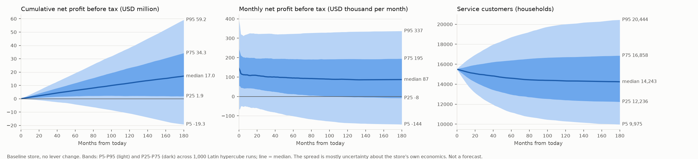

# Summary: how a franchised car dealership makes money, and which levers move profit (single store, US)

**Bottom line (uncertainty bands from a validated model, not a forecast; generic benchmark inputs, not your store's books).**
- **The baseline store earns about $6.24M before tax over five years (median), but the 90% band runs from -$4.22M to $19.24M.** Most of that width is uncertainty about the store's own margins and overhead, not market dynamics: monthly profit today already spans -$66k to $395k. Compare options by their **per-sample gains**, which are tighter.
- **Service and F and I carry the profit; new cars carry the volume.** In the settled base, fixed ops (service and parts) is about 50% of total gross (before technician pay), against a published 50.1% (secondary source), and the service department covers about 69% of fixed overhead (published 69.3%). F and I income is about $1,570 per retail unit by construction (published $1,574).
- **Allocation (equal $10,000 a month of added cost):** only **marketing** beats the baseline more often than not (median $131k over 5 years, positive in 70% of samples). Deeper used inventory (-$504k), a funded F and I programme (-$353k) and two more technicians (-$280k) lose money in at least 61% of samples.
- **Resilience:** a 30% cut in new-vehicle gross for a year costs $487k (24 months: $974k); a 3-point floorplan rate rise $279k; all three shocks together $786k. **Fixed ops does not offset it:** the absorption rate stays near 0.64. A 20% demand drop looks cheap ($49k) only because the model treats it as a postponement (see Model limits).
- **Strategy:** lease-heavy gains a little ($93k median) and its sign depends on resale value against residuals; used-heavy loses (-$338k). **Fixed-ops-heavy wins only because winning service customers is free in the model:** extra service demand is worth about $2.02M over five years (median), so it pays if a programme to win 25% more service customers per sale costs less than that. Technicians alone lose.
- **Valuation (lens D):** discounted cash flow over 10 years has median $7.34M (P5 -$6.16M, P95 $24.01M); this is not a price (no terminal value or tax).
- **What limits behaviour:** the base store sits at rest, so nothing binds until a shock; after one, the **balancing stock-management loops** (new-vehicle ordering and used sourcing) dominate and the 36-month lease echo is small. Ranking stability: the full ranking of 15 scenarios repeats in only 0.5% of samples; the best scenario is one of the two free-service-capture ones in 99%.

Decisions informed (gate 1): four lenses on one single-location franchised store: where to put the next dollars, how exposed profit is to a margin, rate or demand squeeze, which mix to lean toward, and what range of cash flows sits behind a price. Objective: cumulative net profit before tax.

The bands show the spread across 1,000 sampled worlds for the baseline store with no lever change. The losses at the bottom of the first two panels are real parts of the distribution. The wide spread in monthly profit starts at month 0, so it reflects what is not known about the store, not a forecast of drift.

## Cumulative net profit before tax, baseline store (USD; P5 / P25 / median / P75 / P95 across 1,000 samples)

| Horizon | P5 | P25 | Median | P75 | P95 |
|---|---|---|---|---|---|
| Month 60 | -$4.22M | $1.92M | $6.24M | $11.75M | $19.24M |
| Month 120 | -$11.00M | $2.13M | $11.75M | $23.17M | $38.21M |
| Month 180 | -$19.25M | $1.89M | $17.01M | $34.25M | $59.19M |
| Discounted cash flow, month 120 | -$6.16M | $1.86M | $7.34M | $14.17M | $24.01M |
| Monthly net profit, month 60 | -$101k | $13k | $95k | $193k | $323k |

Per-scenario gains, resilience and rankings are in `08_policy.md`.

## What drives profit (Spearman, month-60 cumulative profit)
fixed overhead (-0.47), visits per customer (+0.35), gross per repair order (+0.29), market entry rate (+0.28), parts gross per repair order (+0.27), new gross per vehicle (+0.24). Timing and inventory parameters have |rho| below about 0.15.

## Validation (all gating tests and project checks passed; `validation_report.md`)
- T0 translation identical; T1 units 188/188 consistent; T1b MECE 0 problems; T1c ranges 0 problems; T3 extremes 282 cases, 0 failures; T4 dt halving max change 0.35% (limit 1%); T5 goal-seeking limit case NRMSE 0.08% (limit 10%); T6 conservation drift 6.5e-14 (limit 1e-6); T7 Monte Carlo 1000 samples x 15 scenarios, 0 failed runs; T8 67 loops found = 67 declared.
- **checks.py:** equity identity drift 2.6e-14 relative to inventory at cost; the PySD model equals an independent Euler implementation of the same equations to 9.2e-10 (base and a shocked scenario). The profit-and-loss identity check is exact by construction and adds little.
- **T7b policy ranking:** reported, not gating; not robust (above).
- **Engine change (approved):** a `goal_seeking` analytic reference was added to `engine/validate.py` for the T5 limit case, with a test (`library/validation_tests.md`).

## Model limits: what this model cannot tell you
**Six simplifications with a known direction of bias** (gate 2). The net direction and size are **unquantified**.

| # | Simplification | Bias favours | Tested by |
|---|---|---|---|
| 1 | No price and discount effect on new-car demand | fixed-ops and F and I options (a margin squeeze looks worse than it is) | none |
| 2 | No service-wait and quality effect on retention (parameter A = 0 at base) | service capacity and a fixed-ops-heavy mix | parameter A (retention loss when overloaded) |
| 3 | No credit limit on inventory depth | used-inventory options and a used-heavy mix | none (a credit cap would not change the base) |
| 4 | Manufacturer allocation does not respond to the store's sales (C = 0 at base) | non-new-car options | parameter C (allocation response) |
| 5 | No competitor response | all options, most where competition is closest (service, used) | none |
| 6 | No EV transition or direct (agency) sales | the fixed-ops-heavy mix and the valuation lens | none |

Other limits:
- **Service customers are free to win.** `service capture share` has no cost, so the fixed-ops-heavy result is an **upper bound** on that mix and a hurdle for the cost of the programme that would deliver it.
- **A demand shock is a postponement.** Shoppers who find no stock wait; only buying removes a prospect. A real demand drop loses some of them for good, so the demand-shock loss is a lower bound.
- **Almost every parameter is `estimated`.** Only new-car gross ($2,247), used gross ($1,399) and F and I per unit ($1,574) are `reported`, from Presidio-NCM figures as relayed by Digital Dealer (secondary; the primary NADA/NCM reports were not opened). New-car gross is a squeezed year (down 33% from 2023), so profit is low by recent history and the 2024 margins are not a norm. Replace store scale, fixed overhead and the estimated rates with your own numbers before using any dollar value.
- **Fixed overhead was calibrated once**, so the settled base earns about 2% of sales and an absorption rate near 0.69. Those two matches are consistency checks, not evidence of fit.
- **No capital charge in profit.** Lens A inventory options are costed at floorplan interest; the cash-flow lens includes the equity tied up. Equal-cost sizing of the lens A options is approximate ($10,000 a month each).
- **Lever ranges are exploration ranges.** The Monte Carlo varies the uncertain parameters, not the levers (marketing spend, technicians, lease share, mix and shock inputs). Levers were tested at the 15 scenario settings and by the extreme-condition tests only, so values elsewhere in a lever's range in the explorer are unvalidated interpolations.
- **One shock window.** The margin, rate and demand shocks share one start and duration.
- **Mix scenarios do not hold capital exactly equal.** The strategy options are lever moves of a plausible size, not budget-matched programmes.
- **Base run is at rest.** Its loop-dominance timeline is empty, so dominance is reported on the shocked scenario only.
- **Excluded by design:** tax, body shop, dealer-owned reinsurance, multi-store groups, customer segments, and the trade-in valuation cycle.
- **Replacement cycle and lease term are generic** (ownership period 66 months, range 48-96; lease term 36).
- **The `.mdl` has not been opened in Vensim.** It translates and runs in PySD (the version pinned in `engine/requirements.txt`, used for T0). Whether it opens in Vensim is `[unverified]`.

Licence: original model; no file from `raw/` copied or adapted; **no share-alike source reused** (`sources.md`).
