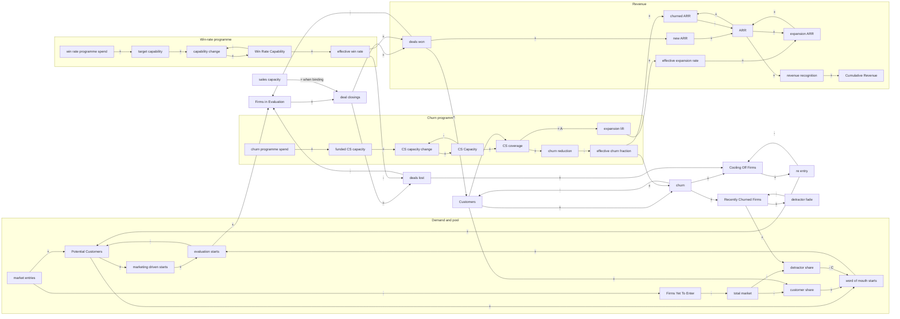

# Gate 3: Dynamic hypothesis and causal loop diagram

**Hypothesis.** The customer engine is the worked example's (`projects/bass-b2b-adoption`): marketing starts
evaluations early (B2), word of mouth through the sales pipeline then drives growth (R1), and depletion, churn and
the pipeline/cool-off delays limit it (B1-B6, recycling R2-R5). Two programmes act on that engine through
explicit capability stocks that goal-seek toward what the budget pays for:
- **Win-rate programme**: spend -> target capability (diminishing returns) -> Win Rate Capability (ramp-up delay,
  B8) -> effective win rate -> deals won. It lifts the gain of R1 and of every recycling loop. No loop runs back
  into it: its effect is open-loop and stops growing once the spend does.
- **Churn programme**: spend -> funded CS capacity -> CS Capacity (ramp-up delay, B7) -> coverage of Customers ->
  churn reduction -> effective churn fraction. Coverage is diluted as Customers grow (B11). The programme is
  therefore pushed back by the growth it helps cause: a limits-to-growth structure with a fixed (budgeted)
  capacity.

Revenue is a separate chain: ARR compounds through expansion (R6) and drains through churned ARR (B10). Neither
feeds back into customers or the budget (fixed dollar schedule, gate 2 item 5). What limits growth is expected to
move from demand and pipeline (B2, B4-B5) early, to CS dilution (B11) and churn (B3) as the base grows. Sales
capacity can bind but forms no loop because it is exogenous (gate 2 item 1, parameter B).

## Causal loop diagram

Edges from an outflow into its stock are drawn `-`. `C` and `A` mark the links scaled by optional parameters C
and A (gate 2). Not drawn: constants; spend schedules (driven by time only); Cumulative Programme Spend (an
accumulator of spend, outside every loop). Market growth uses a source stock, Firms Yet To Enter (gate 4), so the
firm total is conserved; it is outside every loop. Sales capacity grows with time only (parameter B), so it has no
incoming links.

## Loops (21; enumerated from the link list above with `networkx.simple_cycles`, the same method `engine/loop_detector.py` uses; T8 must find exactly these)

| Loop | Pol. | Path | Delay inside | Archetype (`library/archetypes.md`) |
|---|---|---|---|---|
| R1 word of mouth | R | Customers -> customer share -> word of mouth starts -> evaluation starts -> Firms in Evaluation -> deal closings -> deals won -> Customers | sales cycle | Bass imitation, s.4; engine of limits to growth, s.3 |
| B1 saturation via word of mouth | B | Potential -> word of mouth starts -> evaluation starts -> Potential | none | Bass saturation, s.3-4 |
| B2 saturation via marketing | B | Potential -> marketing driven starts -> evaluation starts -> Potential | none | Bass innovation, s.4 |
| B3 churn | B | Customers -> churn -> Customers | none | Bass "add churn", s.4 |
| B4 pipeline drain (won) | B | Firms in Evaluation -> deal closings -> deals won -> Firms in Evaluation | sales cycle | first-order material delay |
| B5 pipeline drain (lost) | B | Firms in Evaluation -> deal closings -> deals lost -> Firms in Evaluation | sales cycle | first-order material delay |
| B6 cool-off drain | B | Cooling Off Firms -> re entry -> Cooling Off Firms | cool-off | first-order material delay |
| R2 lost-deal recycling via marketing | R | Cooling Off -> re entry -> Potential -> marketing starts -> evaluation starts -> Evaluation -> closings -> deals lost -> Cooling Off | sales cycle + cool-off | material recycling (none named) |
| R3 lost-deal recycling via word of mouth | R | as R2 through word of mouth starts | sales cycle + cool-off | same |
| R4 churn recycling via marketing | R | Customers -> churn -> Cooling Off -> re entry -> Potential -> marketing starts -> ... -> deals won -> Customers | both | same |
| R5 churn recycling via word of mouth | R | as R4 through word of mouth starts | both | same |
| B7 CS capacity adjustment | B | CS Capacity -> CS capacity change -> CS Capacity | CS ramp-up | goal seeking, s.2 (goal = funded capacity) |
| B8 enablement adjustment | B | Win Rate Capability -> capability change -> Win Rate Capability | enablement ramp-up | goal seeking, s.2 (goal = target capability) |
| B9 detractor fade | B | Recently Churned Firms -> detractor fade -> Recently Churned Firms | detractor memory | first-order delay |
| R6 expansion compounding | R | ARR -> expansion ARR -> ARR | none | exponential growth, s.1 |
| B10 ARR churn | B | ARR -> churned ARR -> ARR | none | goal seeking toward 0, s.2 |
| B11 CS dilution | B | Customers -> CS coverage -> churn reduction -> effective churn fraction -> churn -> Customers | none in the loop (ramp-up sits on the capacity side) | limits to growth, s.3 (fixed capacity diluted by growth) |
| B12 negative word of mouth **[C]** | B | Customers -> churn -> Recently Churned -> detractor share -> word of mouth starts -> evaluation starts -> Evaluation -> closings -> deals won -> Customers | detractor memory + sales cycle | limits to growth, s.3 |
| B13 negative word of mouth via CS dilution **[C]** | B | Customers -> CS coverage -> churn reduction -> effective churn fraction -> churn -> Recently Churned -> detractor share -> word of mouth starts -> ... -> deals won -> Customers | detractor memory + sales cycle | limits to growth, s.3 |
| R7 CS dilution recycling via marketing | R | Customers -> CS coverage -> churn reduction -> effective churn fraction -> churn -> Cooling Off -> re entry -> Potential -> marketing starts -> ... -> deals won -> Customers | cool-off + sales cycle | material recycling (none named) |
| R8 CS dilution recycling via word of mouth | R | as R7 through word of mouth starts | cool-off + sales cycle | same |

Archetype 9 (market growth / capacity) does **not** appear: capacity investment is not driven by demand or revenue
in this model (fixed budget, exogenous sales capacity). That is gate 2 items 1 and 5, recorded as limits.

Polarity check (signs on each link, "all else equal, if A rises does B rise or fall?"): B11 has three negative links
(Customers -> coverage, churn reduction -> effective churn fraction, churn -> Customers). R7/R8 have two. B12 has
one (detractor share -> word of mouth starts). B13 has three.

## Conditions for T8 (decided now, carried into gates 5-7)
T8 reads each link's sign from the **base run**. A link that never changes there gets no sign, and every loop that
contains it is reported "undetermined", so T8 fails. Consequences:
1. **Base scenario funds both programmes.** Proposal: base = 50/50 split of the budget for all 60 months. "No
   programme" and the four sequences become `[[policies]]`. Otherwise B7, B8, B11, B13, R7 and R8 have no sign.
2. **Sales capacity may not bind for the whole base run.** Otherwise R1-R5, B4-B5 and R7-R8 have no sign on
   Firms in Evaluation -> deal closings. Checked at gate 7, not assumed.
3. **Parameter C = 0 leaves B12 and B13 undetermined.** This conflicts with "default 0" (gate 2). See the open question.

## MECE check (every driver in exactly one sector; T1b enforces it at gate 7)

| Sector | Variables |
|---|---|
| Demand generation | evaluation starts, marketing driven starts, word of mouth starts, customer share, detractor share, marketing reach rate (+ monthly), word of mouth rate (+ monthly), negative word of mouth multiplier (C) |
| Market pool | Potential Customers, Cooling Off Firms, re entry, cool off time, Firms Yet To Enter, initial firms yet to enter, market entries, market growth rate (+ monthly), market growth horizon, market growth active, initial total market, total market, initial cooling off firms |
| Sales pipeline | Firms in Evaluation, deal closings, deals won, deals lost, sales cycle time, sales capacity, initial sales capacity, sales capacity growth rate (B), initial firms in evaluation |
| Customer base | Customers, churn, base churn rate (+ monthly), effective churn fraction, Recently Churned Firms, detractor fade, detractor memory time, initial customers |
| Churn programme | churn programme spend, funded CS capacity, CS cost per covered firm, CS Capacity, CS capacity change, CS ramp-up time, CS coverage, minimum customer base for coverage, CS effect, coverage scale, churn reduction, maximum churn reduction |
| Win-rate programme | win rate programme spend, target capability, win spend scale, Win Rate Capability, capability change, enablement ramp-up time, base win rate, maximum win rate uplift, effective win rate |
| Revenue | ARR, new ARR, expansion ARR, churned ARR, new customer ACV, base net expansion rate (+ monthly), expansion lift, expansion lift at full CS effect (A), effective expansion rate (+ monthly), revenue recognition, Cumulative Revenue, cumulative revenue net of programme spend |
| Budget | total programme budget, programme months, monthly programme budget, programme active, phase switch month, churn share phase 1, churn share phase 2, churn share now, total programme spend, Cumulative Programme Spend |
| Unit conversion | months per year |

No two variables mean the same thing: base vs effective win rate, base churn rate vs effective churn fraction, and
churn (Firm/Month) vs churned ARR (USD/Year per Month) are kept distinct on purpose. Customer share and detractor
share use the same denominator but different stocks. Final names and the exact list are fixed at gate 5;
T1b checks them against the `.mdl`.

## Decision on parameter C (approved with gate 3: option a)
T8 reads link signs for this model from a polarity run: the base run with parameter C set to a nonzero value inside
its range, declared in `validation.toml` as `[loop_check] set = { "negative word of mouth multiplier" = <value> }`
(gate 5 picks the value). C's base stays 0 (gate 2). Loop scores and the dominance timeline still come from the true
base run, where B12 and B13 score 0. The block is named `[loop_check]`, not `[loops]`, because `[[loops]]` already
holds the declared loops and TOML cannot have both. Engine change: `engine/validate.py` (T1c checks each override is
inside its parameter's [low, high]; T8 uses the override run for polarity; the report names it), documented in
`library/validation_tests.md` T8, tested by three new tests in `engine/tests/test_validate.py` (125/125 engine tests pass).
No tolerance changed.

## Amendment 2026-10-29 (gate 5 approval): loop B14 expansion ceiling
The expansion ceiling adds links ARR -> ARR per customer (+), Customers -> ARR per customer (-), ARR per customer ->
expansion headroom (-) and expansion headroom -> expansion ARR (+). These form one new loop. The declared set is
now **22 loops**, regenerated from the full link list with `networkx.simple_cycles` into `validation.toml`:

| Loop | Pol. | Path | Delay inside | Archetype |
|---|---|---|---|---|
| B14 expansion ceiling | B | ARR -> ARR per customer -> expansion headroom -> expansion ARR -> ARR | none | limits to growth, s.3 (R6 compounding meets a ceiling) |

Customers -> ARR per customer closes no loop, because ARR never feeds back into Customers. B14 is active in the base
run (base net expansion 0.09 > 0), so it needs no `[loop_check]` override. Revenue sector additions: ARR per customer,
expansion headroom, expansion ceiling multiple. "minimum customer base for coverage" is renamed **minimum customer
base** and moved to the customer base sector, because both CS coverage and ARR per customer now divide by it.
