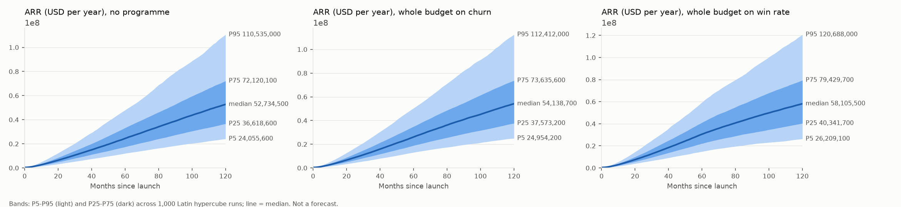
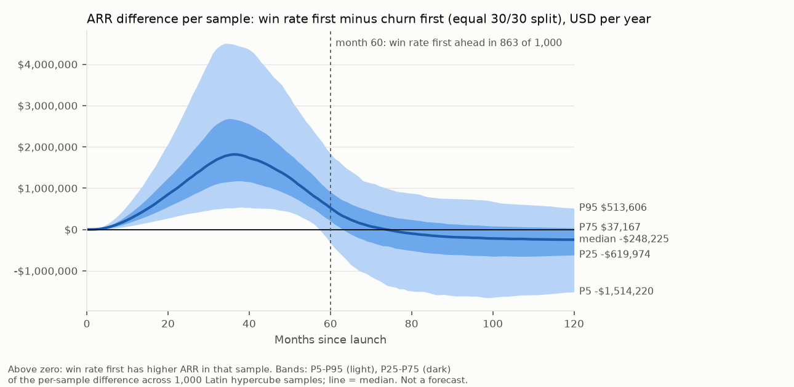

# Summary: fund churn reduction or a higher win rate first? (B2B SaaS, 5-year budget)

**Bottom line (uncertainty bands from a validated model, not a forecast; generic benchmark inputs, not your data).**
- **Every funded option raises ARR at month 60 over no programme in at least 95% of samples, but churn only adds
  the least.** Its median gain is +$1.5M (90% band $0.6M-3.5M), against +$5.46M for the 50/50 split and +$5.75M for
  win rate only. Net of its cost it loses money over the 5 years in 647 of 1,000 samples.
- **Order, with equal months (30/30, the primary comparison).** Win rate first is ahead on ARR at month 60 in
  **863 of 1,000** samples and on cumulative revenue net of spend in **998 of 1,000**. Churn first is ahead by
  month 120 in **724 of 1,000**. Across a 64-fold range of relative cost-effectiveness (k from 1/8 to 8), the
  month-60 order never changes in 875 of 1,000 samples: **841 stay win rate first and 34 stay churn first**.
  The other 125 flip somewhere on that range.
- **Order as originally defined (24/36 split, a variant).** "Churn first" is ahead at month 60 in 724 of 1,000. This
  comes mostly from the 12 extra months it gives the win-rate programme, not from the order.
- **Which option gives the highest ARR at month 60 is not settled.** Win rate only does in 675 of 1,000 samples,
  the 50/50 split in 325, and the others in none. The full ranking repeats in only 60.4% of samples.
- **In the customer-loop view, growth is limited first by word of mouth through the pipeline and then by churn.**
  Sales capacity caps closings, binding before month 60 in about half the samples. That last finding rests on an
  **illustrative** sales-capacity input (see Model limits).

Decision informed (gate 1): how to sequence one fixed 5-year budget between a churn programme (customer success) and
a win-rate programme (sales enablement), judged by ARR at month 60.

The panels show the spread across 1,000 sampled worlds. The bands overlap heavily, so compare policies by the
**per-sample** differences above, not by eye across panels.

The order question shown directly. In each sample, ARR under win rate first minus ARR under churn first (equal
30/30 split), in USD per year; above zero means win rate first is ahead in that sample.
- **The median difference peaks at +$1.82M at month 36** (`median_peak`).
- **At month 60 it is +$0.52M** (90% band -$0.33M to +$1.84M), with win rate first ahead in 863 of 1,000 samples
  (`at_month.60`).
- **It first reaches zero or below at month 74** (`median_first_month_at_or_below_zero_after_peak`). That is also the
  first month after the peak in which win rate first is ahead in fewer than half the samples
  (`share_win_first_first_month_below_half_after_peak`).
- **By month 120 the median is -$0.25M** (90% band -$1.51M to +$0.51M), with churn first ahead in 724 of 1,000
  (`at_month.120`).

Sources: the monthly rows of `order_difference_bands.csv` (written by `gate8_analysis.py`). The statistics above
are computed from those rows by `gate9_difference_chart.py` and stored, under the keys quoted, in
`order_difference_summary.json`. The chart is drawn from the same CSV.

## ARR by scenario (USD million per year; P5 / P25 / median / P75 / P95 across 1,000 samples)

Generated from `scenario_bands.csv`, rounded half-up to one decimal.

| Scenario | Month 12 | Month 36 | Month 60 | Month 120 |
|---|---|---|---|---|
| no programme | 1.7 / 2.6 / 3.4 / 4.5 / 6.3 | 6.6 / 9.8 / 13.2 / 17.7 / 25.8 | 12.0 / 17.4 / 24.4 / 33.2 / 48.0 | 24.1 / 36.6 / 52.7 / 72.1 / 110.5 |
| churn only | 1.7 / 2.7 / 3.4 / 4.5 / 6.4 | 7.0 / 10.3 / 13.9 / 18.6 / 26.7 | 13.1 / 18.9 / 26.1 / 34.9 / 50.4 | 25.0 / 37.6 / 54.1 / 73.6 / 112.4 |
| win rate only | 1.9 / 2.9 / 3.8 / 5.0 / 7.1 | 8.0 / 12.0 / 16.1 / 21.7 / 31.0 | 14.8 / 22.1 / 30.5 / 41.1 / 59.4 | 26.2 / 40.3 / 58.1 / 79.4 / 120.7 |
| 50/50 split | 1.9 / 2.9 / 3.8 / 5.0 / 7.0 | 8.1 / 11.9 / 15.9 / 21.3 / 30.4 | 15.0 / 21.9 / 30.2 / 40.1 / 57.8 | 26.3 / 40.0 / 57.7 / 78.9 / 119.5 |
| churn first, 24/36 (variant) | 1.7 / 2.7 / 3.4 / 4.5 / 6.4 | 7.3 / 10.8 / 14.4 / 19.3 / 27.9 | 14.2 / 20.7 / 28.7 / 38.4 / 56.2 | 25.8 / 39.4 / 56.9 / 77.6 / 117.5 |
| win rate first, 24/36 (variant) | 1.9 / 2.9 / 3.8 / 5.0 / 7.1 | 8.0 / 11.7 / 15.7 / 21.1 / 30.1 | 14.1 / 20.4 / 28.2 / 37.5 / 53.9 | 25.6 / 38.8 / 55.8 / 76.1 / 115.0 |

Every scenario spends the same total budget (base $3M over 60 months, sampled $1.5M-6M: configured inputs from
`validation.toml`, documented in `assumptions_register.md`). Per-sample gains, net-of-cost
results, the 30/30 order comparison and the break-even ratio are in `08_policy.md`.

## What limits growth
| Period | Binding limit | Evidence |
|---|---|---|
| Months 0.25-8.5 | Demand reaching the pipeline (word of mouth, R1) | Customer-restricted loop dominance, base parameters: R1 dominant months 0.25-8.5, mean share 0.86 (`gate8_results.json`, `dominance_customer_loops_base_run`) |
| Months 8.75-120 | Sales capacity caps closings; churn (B3) is the dominant feedback on customers | Customer-restricted view: B3 dominant months 8.75-120, mean share 0.96 (same key). Capacity first binds at month 8.5 at base parameters (`capacity_onset_base_runs`), and before month 60 in 515-564 of 1,000 samples. **Conditional on the illustrative capacity input** |
| Beyond 5 years | Churn (B3) still dominant; retention gains catch up | Churn first (30/30) ahead by month 120 in 724 of 1,000 (`order_only.count_churn_first_beats_win_first.arr_m120`) |

The engine's model-wide loop dominance names an information side loop (B9 detractor fade), which does not affect
customers at base. Statements here use only the **customer-restricted** view, labeled as such; both views are in
`08_policy.md`.

## Leverage (Spearman across 1,000 samples)
- **The 30/30 order** turns most on enablement ramp-up time (-0.42) and initial sales capacity (-0.32). A
  **faster** enablement ramp-up or **less** sales capacity makes churn first ahead more often.
  - **What "78, 48, 11" counts.** Split the 1,000 samples into thirds by enablement ramp-up time: 3.1-6.0 months
    (333 samples), 6.0-7.8 months (334) and 7.8-11.9 months (333). The numbers are how many samples in each third
    have **churn first ahead of win rate first on ARR at month 60** with the equal 30/30 split: 78 of 333, 48 of 334
    and 11 of 333.
  - Split the same way by initial sales capacity (21-49, 49-70 and 70-120 closings a month), the counts are 71 of
    333, 42 of 334 and 24 of 333.
- **Win rate only vs 50/50** turns on maximum win-rate uplift (+0.45), the budget (-0.34), maximum churn reduction
  (-0.29) and CS-driven expansion (A, -0.28).
- **Break-even cost-effectiveness (30/30).** Only 125 samples flip on the grid. Their median k\* is 0.53 (90% band
  0.15-1.68), where k = 1 means both programmes are exactly as cost-effective as assumed, and k > 1 means win-rate
  dollars work better relative to churn dollars.

## Validation (all gating tests and project checks passed; `validation_report.md`, `validation_log.md`)
- **T0 translation:** identical, compared with dependency-key order normalized (engine change approved and recorded).
- **T1 units:** 90/90 consistent. **T1b MECE:** 0 problems. **T1c ranges:** 0 problems.
- **T3 extremes:** 112 cases, 0 failures.
- **T4 dt halving:** max change 0.18% (limit 1%).
- **T5 Bass limit case:** NRMSE 0.04% (limit 10%); peak error 0.033 months (limit 0.05).
- **T6 conservation:** drift 6.9e-15 (limit 1e-6).
- **T7 Monte Carlo:** 1,000 samples x 6 scenarios, 0 failed runs.
- **T8 loops:** 22 found = 22 declared.
- **checks.py:** customers reproduce `bass-b2b-adoption` bit for bit (max difference 0 over 481 steps); ARR identity
  error 8e-16. A mutation test confirms the regression check fails when a neutral term is switched on.

## Model limits: what this model cannot tell you
**Six simplifications with a known direction of bias** (gate 2). Each direction is for that item alone. The net
direction and size are **unquantified**. Defaults and ranges of the testing parameters (A = B = C = 0 at base,
expansion ceiling multiple 2.0) are configured inputs from `validation.toml` (`assumptions_register.md`).

| # | Simplification | Bias favours | Tested by |
|---|---|---|---|
| 1 | No revenue -> hiring -> sales capacity feedback (capacity fixed) | churn programme | parameter B (time-driven proxy) |
| 2 | No customer success -> expansion at base (A = 0) | win-rate programme | parameter A |
| 3 | No negative word of mouth from churners at base (C = 0) | win-rate programme | parameter C (little effect in its range) |
| 4 | No competitor response to a higher win rate | win-rate programme | none |
| 5 | No reinvestment of ARR into the budget | churn programme (if win rate raises ARR sooner) | none (share-of-ARR variant not built) |
| 6 | Expansion capped on average ARR per customer, no cohorts | win-rate programme | expansion ceiling multiple |

Other limits:
- **Sales capacity is illustrative.** 45 closings a month (range 20-120), constant unless B > 0, with no benchmark
  behind it (configured input: `validation.toml`, `assumptions_register.md`). "Sales capacity limits growth", and the explanation of why win rate leads at month 60, are conditional
  on it. Replace it with your team's real capacity.
- **The programme budget is illustrative.** $3M over 60 months (range $1.5M-6M; configured input: `validation.toml`,
  `assumptions_register.md`), not a planned figure. Gains per
  dollar and the win rate only vs 50/50 comparison depend on it (Spearman -0.34). Replace it with your budget.
- **Parameters come from secondary sources.** No historical data. Every benchmark (ACV, retention, CSM cost, churn
  and win-rate effects, sales cycle, win rate, churn) was read through web summaries or vendor pages, not the
  primary reports (`assumptions_register.md`, `sources.md`). Replace market size, ACV, churn and win rate with your
  own numbers before using the bands.
- **Programme effects are the weakest inputs.** Churn reduction from CS rests on blog claims and one null finding.
  Win-rate uplift is a survey correlation. Both are tagged `estimated` or `reported` with wide ranges.
- **Costs beyond the programme budget are not modelled.** No sales commissions, no cost of serving more customers,
  no discounting.
- **Homogeneous firms and constant parameters for 10 years.** One segment, no product or price change. Churners carry
  average ARR (S9); if small accounts churn more, churn reduction is overstated.
- **The share-of-ARR budget variant is untested.** The gate 1 sensitivity run (budget as a share of ARR) needs its
  own model and its own validation. It has not been built or run, so nothing here speaks to it.
- **The `.mdl` has not been opened in Vensim.** It translates and runs in PySD 3.14.3, the version pinned in
  `engine/requirements.txt` and used for T0. Whether it opens in Vensim is `[unverified]` (no Vensim in this
  environment).

Licence: original model; no file from `raw/` copied or adapted; **no share-alike source reused** (`sources.md`).
